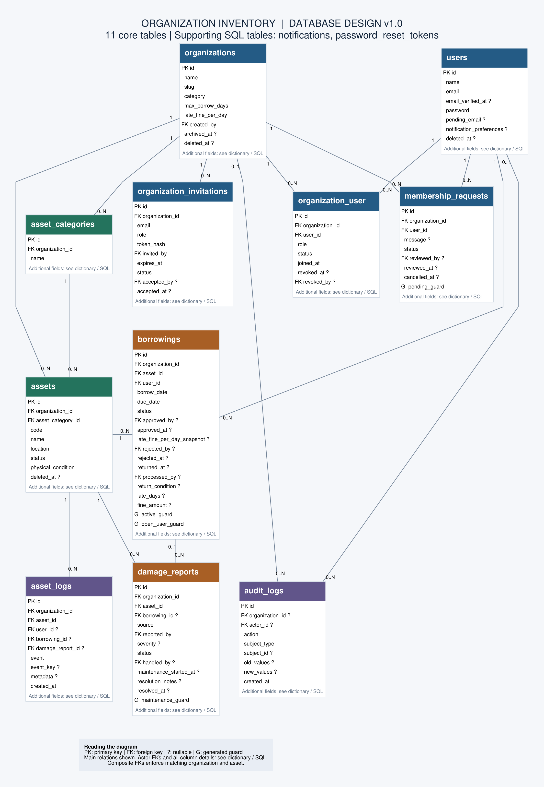
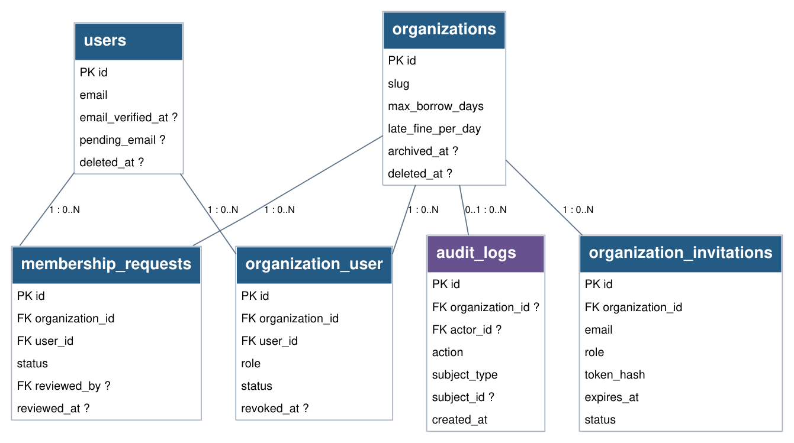
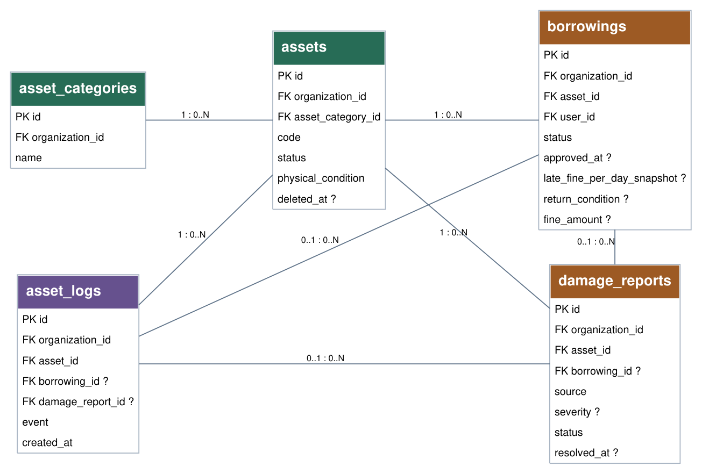

# Software Requirements Specification (SRS)

## Organization Inventory — Sistem Pengelolaan Barang

| Parameter | Detail |
| --- | --- |
| **Nama Dokumen** | SRS Organization Inventory (Sistem Pengelolaan Barang) |
| **Versi** | 1.2 (Biaya kerusakan dan pembayaran manual; draft review) |
| **Tanggal** | 27 Oktober 2026 |
| **Target Rilis** | Phase 1 (MVP) |
| **Sumber** | PRD Organization Inventory v0.4, proposal proyek, flowchart yang dirujuk versi 1.0, dan Desain Database Organization Inventory v1.0 (20 Oktober 2026) |
| **Standar Acuan** | Struktur mengikuti IEEE 830 / ISO/IEC/IEEE 29148, disesuaikan untuk proyek MVP |

Revisi 1.2 menambah tagihan kerusakan/loss, pembayaran manual, dan pembebasan saldo: target 14 tabel inti dan 2 pendukung. Baseline revisi 1.1 memuat 11 tabel inti dan 2 pendukung dari desain database v1.0. Keputusan teknis yang berubah dijelaskan pada bagian 10.6; pembaruan ini merupakan revisi perancangan, bukan pernyataan bahwa implementasi atau pengujian aplikasi telah selesai.

## Daftar Isi

1. [Pendahuluan](#1-pendahuluan)
2. [Deskripsi Umum](#2-deskripsi-umum)
3. [Kebutuhan Antarmuka Eksternal](#3-kebutuhan-antarmuka-eksternal)
4. [Kebutuhan Fungsional](#4-kebutuhan-fungsional)
5. [Use Case](#5-use-case)
6. [Aturan Bisnis](#6-aturan-bisnis)
7. [Kebutuhan Data](#7-kebutuhan-data)
8. [Kebutuhan Non-Fungsional](#8-kebutuhan-non-fungsional)
9. [Matriks Keterlacakan (Traceability)](#9-matriks-keterlacakan-traceability)
10. [Lampiran](#10-lampiran)

---

## 1. Pendahuluan

### 1.1 Tujuan

Dokumen ini mendefinisikan kebutuhan perangkat lunak untuk **Organization Inventory**, yaitu aplikasi web multi-organisasi untuk mengelola aset, peminjaman, pengembalian, dan riwayat penggunaan barang berbasis QR Code. Dokumen ditujukan bagi:

| Pembaca | Kegunaan |
| --- | --- |
| Pemilik produk | Memvalidasi bahwa kebutuhan sudah sesuai harapan |
| Developer / AI agent | Acuan implementasi (fungsional, data, aturan bisnis) |
| QA / Tester | Dasar penyusunan skenario dan kriteria uji |
| Pemangku kepentingan lain | Memahami cakupan dan batasan MVP |

### 1.2 Ruang Lingkup

Organization Inventory menjawab masalah pengelolaan barang yang masih manual (spreadsheet/kertas), yaitu aset sulit dilacak, riwayat peminjaman sulit ditelusuri, dan informasi aset tersebar.

**Dalam lingkup (MVP):**

- Autentikasi (registrasi dengan verifikasi email, login, reset password).
- Multi-organisasi: Explore, pembuatan organisasi, join request, undangan email.
- Role per organisasi (Admin, Staff, Member) dan pembatasan akses.
- Manajemen inventory (aset, kategori) dan QR Code (generate, download, print, scan).
- Peminjaman, inspeksi, OVERDUE, denda keterlambatan, biaya kerusakan/loss, serta pencatatan pembayaran/pelunasan manual (F12).
- Damage report dan maintenance, kondisi fisik terkini, riwayat aset (asset log), dan audit tindakan sensitif lintas entitas.
- Notifikasi (in-app, email, pop-up toast).
- Dashboard (Member dan Admin/Staff), export laporan CSV, Profile/Settings.

**Di luar lingkup (MVP):** payment gateway, pemindahan uang otomatis, refund, pembayaran sewa/deposit, sistem stok/kuantitas, reservasi jadwal, export PDF/Excel, notifikasi real-time berbasis WebSocket, aplikasi mobile native, multi-bahasa, integrasi pihak ketiga selain email.

### 1.3 Definisi, Akronim, dan Istilah

| Istilah | Definisi |
| --- | --- |
| **Organisasi / Ruang Inventaris** | Wadah pengelolaan barang individu/kelompok; pembuat menjadi Admin per ruang. Kembali ke dashboard pribadi tidak mencabut role. |
| **Aset** | Satu unit barang fisik. Satu aset = satu record = satu QR Code. |
| **Admin** | Pengelola penuh organisasi (anggota, aset, peminjaman, laporan, pengaturan). |
| **Staff** | Pengelola operasional (aset, peminjaman, pengembalian, maintenance), tanpa akses anggota, laporan, dan pengaturan. |
| **Pengguna terdaftar** | Akun pribadi, termasuk yang belum mempunyai membership; dapat membuat ruang setelah verifikasi. |
| **Member** | Anggota biasa: melihat katalog, mengajukan peminjaman, scan QR, melapor kerusakan. |
| **Join Request** | Permintaan user untuk bergabung ke organisasi, perlu persetujuan Admin. |
| **Undangan (Invitation)** | Ajakan bergabung yang dikirim Admin ke email tertentu, berlaku 7 hari. |
| **Inspeksi** | Pemeriksaan kondisi aset saat dikembalikan: Good, Minor Damage, Major Damage, Lost. |
| **OVERDUE** | Status peminjaman yang melewati tanggal estimasi pengembalian dan belum dikembalikan. |
| **Damage Report** | Catatan kerusakan aset beserta tindak lanjutnya. |
| **Asset Log** | Catatan kronologis setiap peristiwa penting pada suatu aset. |
| **Slug** | Pengenal URL unik organisasi (mis. `himpunan-it`); tidak berubah setelah dibuat agar URL QR tetap valid. |
| **ULID** | Identifier publik 26 karakter pada `assets.code`; unik dan immutable. |
| **Audit Log** | Catatan append-only actor, aksi, objek, dan perubahan sensitif lintas entitas. |
| **Kondisi fisik** | Kondisi terkini (`good/minor_damage/major_damage/unknown`), terpisah dari status ketersediaan aset. |
| **Snapshot kebijakan** | Salinan tarif denda dan batas durasi ketika pinjaman disetujui; tidak berubah mengikuti settings terbaru. |
| **Soft delete** | Penghapusan logis (data ditandai terhapus, tidak dihapus fisik). |
| **MVP** | Minimum Viable Product, rilis awal (Phase 1). |
| **RBAC** | Role-Based Access Control. |
| **IDOR** | Insecure Direct Object Reference, akses data milik pihak lain lewat manipulasi ID/URL. |

### 1.4 Referensi

| Dokumen | Keterangan |
| --- | --- |
| PRD — Organization Inventory v0.4 | Sumber kebutuhan produk F01–F12 dan acceptance criteria |
| Proposal Organization Inventory | Lingkup MVP, model data, peran, dan perencanaan proyek |
| Desain Database Organization Inventory v1.0 | ERD, 13 tabel, SQL MySQL 8.0.16+, kamus data, dan aturan transaksi |
| Flowchart Landing Page & Login Page | Alur guest: Explore, Register, Login, Forgot Password |
| Flowchart Dashboard User | Alur Member: Profile, My Organizations, Notification, My Borrowing, Scan QR |
| Flowchart Dashboard Organisasi | Alur Admin/Staff: Inventory, Borrowings, Members, Damage Reports, Settings |
| Klarifikasi pemilik produk | Keputusan yang menyelesaikan perbedaan PRD dan flowchart (lihat Lampiran 10.3) |

### 1.5 Gambaran Dokumen

Bagian 2 menjelaskan konteks produk dan pengguna. Bagian 3 menjelaskan antarmuka. Bagian 4 memuat kebutuhan fungsional per modul (ID `FR-*`). Bagian 5 memuat use case. Bagian 6 memuat aturan bisnis (ID `BR-*`). Bagian 7 memuat model data. Bagian 8 memuat kebutuhan non-fungsional (ID `NFR-*`). Bagian 9 memetakan PRD ke kebutuhan. Lampiran berisi route, keputusan desain, dan asumsi.

Seluruh kebutuhan berprioritas **Must** (MVP) kecuali disebutkan lain.

---

## 2. Deskripsi Umum

### 2.1 Perspektif Produk

Aplikasi web mandiri (monolit Laravel) dengan basis data relasional. Aplikasi bersifat **multi-organisasi** dalam satu database: data dipisahkan per organisasi lewat `organization_id`, dan role disimpan **per organisasi** pada `organization_user`. Hanya membership berstatus `active` dengan akun/organisasi yang belum soft delete yang memberi akses; baris `revoked` dipertahankan untuk histori. Satu user dapat menjadi Admin di satu organisasi dan Member di organisasi lain.

Aplikasi berinteraksi dengan: (1) server email (SMTP) untuk verifikasi, reset password, undangan, dan notifikasi; (2) kamera perangkat untuk scan QR; (3) scheduler server untuk penandaan OVERDUE otomatis; (4) queue worker untuk pengiriman email.

### 2.2 Fungsi Utama Produk

| Area | Ringkasan Fungsi |
| --- | --- |
| Autentikasi | Register + verifikasi email, login, lupa/reset password |
| Multi-organisasi | Explore, buat organisasi, join request, undangan email, kelola anggota dan role |
| Inventory | CRUD aset dan kategori, foto aset, katalog untuk Member |
| QR Code | Generate, download PNG/SVG, print stiker, scan via kamera |
| Peminjaman | Request, approve/reject, borrowed, overdue, return + inspeksi, denda |
| Kondisi aset | Damage report, maintenance, tandai ditemukan |
| Riwayat | Timeline log per aset |
| Notifikasi | In-app, email, toast, preferensi |
| Analitik | Dashboard, grafik, export CSV |
| Akun | Profil, email, password, preferensi, hapus akun |

### 2.3 Karakteristik Pengguna

| Aktor | Deskripsi | Hak Akses Ringkas | Tingkat Keahlian |
| --- | --- | --- | --- |
| **Guest** | Pengunjung belum login | Landing, Explore, profil publik organisasi, Register, Login | Awam |
| **Member** | Anggota organisasi | Katalog, request borrow, scan QR, lapor kerusakan, My Borrowing | Awam |
| **Staff** | Petugas operasional | Semua hak Member + kelola aset, kategori, peminjaman, pengembalian, damage report, dashboard | Menengah |
| **Admin** | Pengelola organisasi | Semua hak Staff + anggota, report/export, settings organisasi | Menengah |
| **Sistem (Scheduler)** | Proses otomatis | Menandai OVERDUE, mengirim notifikasi terkait | Tidak berlaku |

Pembuat organisasi otomatis menjadi Admin organisasi tersebut. Sebuah organisasi boleh memiliki lebih dari satu Admin.

### 2.4 Batasan (Constraints)

| ID | Batasan |
| --- | --- |
| CON-01 | Backend: Laravel (PHP) dengan Eloquent ORM. |
| CON-02 | Frontend: Blade + Livewire, Tailwind CSS, Flux UI. |
| CON-03 | Database implementasi MVP: MySQL 8.0.16+ dengan InnoDB dan strict SQL mode. PostgreSQL pada PRD merupakan alternatif awal; pemakaiannya memerlukan adaptasi DDL dan validasi terpisah. |
| CON-04 | QR Code: Simple QrCode (backend) dan html5-qrcode (scanner frontend). |
| CON-05 | Grafik: Chart.js. Penyimpanan file: Laravel Storage. Validasi: Laravel Form Request. |
| CON-06 | Scan kamera memerlukan HTTPS (kecuali `localhost`) dan izin kamera dari pengguna. |
| CON-07 | Generate QR format PNG bergantung pada ekstensi `imagick`; SVG selalu tersedia. |

### 2.5 Asumsi dan Dependensi

| ID | Asumsi / Dependensi |
| --- | --- |
| ASM-01 | Pengguna memiliki alamat email aktif untuk verifikasi dan notifikasi. |
| ASM-02 | Server menjalankan queue worker dan cron scheduler (`schedule:run` tiap menit). |
| ASM-03 | Layanan SMTP tersedia di produksi (di development memakai driver `log`). |
| ASM-04 | Kalender bisnis `Asia/Jakarta`, mata uang Rupiah, UI Indonesia. Timestamp disimpan UTC; `borrow_date` dan `due_date` memakai tanggal kalender bisnis. |
| ASM-05 | Satu aset adalah satu unit fisik (tidak ada stok/kuantitas). |
| ASM-06 | Pengguna memakai browser modern (lihat NFR-PORT-01). |

### 2.6 Cakupan MVP

Mengacu pada PRD bagian "MVP Scope (Diperbarui)", seluruh butir berikut masuk Phase 1: Autentikasi; Otorisasi dan Role (termasuk UI grayed-out untuk Staff); Multi-Organisasi (Explore dan Join); Manajemen Inventory (CRUD Aset dan Kategori); Sistem QR Code (generate dan scan); Sistem Peminjaman dan Pengembalian; Riwayat Aset; Dashboard Utama. Berdasarkan flowchart, ditambahkan pula Damage Reports, Notifikasi, Settings organisasi, dan Report (export CSV).

---

## 3. Kebutuhan Antarmuka Eksternal

### 3.1 Antarmuka Pengguna

Antarmuka berbasis web, responsif (prioritas mobile karena scan QR dilakukan di HP), berbahasa Indonesia, dengan toast/alert untuk umpan balik aksi. Struktur menu:

| Area | Menu / Halaman |
| --- | --- |
| Publik (Guest) | Landing, Explore Organization, Profil Publik Organisasi, Login, Register, Lupa Password, Reset Password, Terima Undangan |
| User (Member) | Home, Organizations (Semua Organisasi / Organisasi Saya), My Borrowing (Active / Pending / History), Notifications, Scan QR, Profile/Settings |
| Katalog Organisasi (anggota) | Daftar aset, Detail Aset (aksi: Ajukan Peminjaman, Laporkan Kerusakan, History) |
| Manajemen Organisasi (Admin/Staff) | Dashboard, Inventory, Kategori, Borrowing (Pending Request / Active Borrowing / History), Members, Damage Reports, Reports, Settings |

Item **Members, Reports, dan Settings** ditampilkan **nonaktif (grayed out)** untuk Staff dengan tooltip "Hanya untuk Admin".

### 3.2 Antarmuka Perangkat Keras

| Perangkat | Kebutuhan |
| --- | --- |
| Kamera (HP/laptop) | Untuk scan QR Code melalui browser |
| Printer | Untuk mencetak stiker QR (opsional) |

### 3.3 Antarmuka Perangkat Lunak

| Komponen | Antarmuka |
| --- | --- |
| Database | MySQL 8.0.16+ / InnoDB via Eloquent ORM |
| Email | SMTP (verifikasi, reset password, undangan, notifikasi) |
| Queue | Driver database untuk pengiriman email dan listener notifikasi |
| Scheduler | Cron memanggil `php artisan schedule:run` |
| Storage | Laravel Storage (disk `public`) untuk foto dan logo |

### 3.4 Antarmuka Komunikasi

HTTP/HTTPS antara browser dan server. Komunikasi dengan server email melalui SMTP. Pembaruan notifikasi di browser memakai polling berkala (tanpa WebSocket pada MVP).

---

## 4. Kebutuhan Fungsional

### 4.1 Autentikasi dan Landing

| ID | Kebutuhan | Prioritas |
| --- | --- | --- |
| FR-AUTH-01 | Landing page menampilkan tiga jalur navigasi: Explore Organization, Login, dan Register. | Must |
| FR-AUTH-02 | Register menerima Nama, Email, dan Password (dengan konfirmasi; minimal 8 karakter). | Must |
| FR-AUTH-03 | Sistem memvalidasi keunikan email. Jika sudah terdaftar, tampilkan "Email sudah terdaftar" dan pengguna tetap di form. | Must |
| FR-AUTH-04 | Jika email belum terdaftar, sistem menyimpan akun ke database, mengirim email verifikasi, lalu mengarahkan pengguna ke halaman Login dengan pesan sukses. | Must |
| FR-AUTH-05 | Akun wajib terverifikasi email sebelum mengakses area user. Pengguna belum terverifikasi diarahkan ke halaman verifikasi dengan tombol kirim ulang (dibatasi rate limit). | Must |
| FR-AUTH-06 | Login memakai Email dan Password. Jika salah tampilkan pesan tunggal "Email atau password salah"; jika benar menuju halaman dashboard. | Must |
| FR-AUTH-07 | Lupa password: pengguna memasukkan email. Jika tidak ditemukan tampilkan "Email tidak ditemukan"; jika ditemukan sistem mengirim link reset password, lalu pengguna mengatur password baru dan kembali ke Login. | Must |
| FR-AUTH-08 | Pengguna dapat Logout dan sesi diakhiri. | Must |
| FR-AUTH-09 | Pengguna yang sudah login dan membuka halaman guest (landing/login/register) diarahkan ke dashboard. | Must |

### 4.2 Explore Organization (Publik)

| ID | Kebutuhan | Prioritas |
| --- | --- | --- |
| FR-EXP-01 | Menampilkan daftar organisasi (tidak diarsipkan) dengan pencarian nama, filter kategori, dan pagination. | Must |
| FR-EXP-02 | Pengguna dapat membuka profil publik organisasi (nama, kategori, deskripsi, logo, jumlah anggota, jumlah aset) tanpa menampilkan daftar aset atau data sensitif. | Must |
| FR-EXP-03 | Pengguna dapat kembali ke daftar dan ke halaman utama kapan saja. | Must |
| FR-EXP-04 | Tombol "Ajukan Bergabung" pada profil publik mengarahkan guest ke login (URL tujuan disimpan), lalu menjalankan alur join request. | Must |

### 4.3 Organisasi, Keanggotaan, dan Settings

| ID | Kebutuhan | Prioritas |
| --- | --- | --- |
| FR-ORG-01 | Setiap user terautentikasi dan terverifikasi dapat membuat organisasi. Slug unik otomatis bersifat immutable; organisasi dan membership Admin pembuat dibuat dalam satu transaksi. Default `max_borrow_days` 7 dan `late_fine_per_day` 0. | Must |
| FR-ORG-02 | Jika pembuatan organisasi gagal, tampilkan "Gagal membuat organisasi" beserta detail validasi. Jika berhasil, kembali ke Organisasi Saya. | Must |
| FR-ORG-03 | Halaman Organizations memiliki tab "Semua Organisasi" (search dan filter) dan "Organisasi Saya". Setiap organisasi menampilkan status user: belum bergabung, menunggu persetujuan, atau sudah bergabung (dengan badge role). | Must |
| FR-ORG-04 | Tombol "Buka" pada organisasi: Admin/Staff menuju dashboard manajemen; Member menuju katalog aset. | Must |
| FR-ORG-05 | User yang belum menjadi anggota aktif dapat mengirim/membatalkan Join Request. Maksimal satu request PENDING per pasangan user–organisasi; pengajuan ulang setelah keputusan disimpan sebagai baris request baru. | Must |
| FR-ORG-06 | Admin dapat Approve/Reject Join Request. Approve membuat atau mereaktivasi membership sebagai member dalam transaksi yang sama; keanggotaan aktif yang sudah ada tidak digandakan atau diturunkan rolenya. | Must |
| FR-ORG-07 | Admin mengundang email dengan role staff/member. Token acak sekali pakai berlaku 7 hari; database menyimpan `token_hash` unik. Kirim ulang merotasi token dan masa berlaku 7 hari; pencabutan dan pengiriman ulang diaudit. | Must |
| FR-ORG-08 | Penerimaan memvalidasi hash, status PENDING, waktu sebelum expires_at, serta email aktif terverifikasi yang sama. Membership dan accepted_by/accepted_at disimpan atomik. Token tidak valid/kedaluwarsa dan email berbeda ditolak; anggota aktif tidak dibuat ulang atau diubah rolenya oleh penerimaan ulang. | Must |
| FR-ORG-09 | Admin melihat anggota, mengubah role admin/staff/member, dan mencabut keanggotaan. Pencabutan mengubah status menjadi revoked, menyimpan revoked_at/revoked_by, dan mempertahankan baris untuk histori. | Must |
| FR-ORG-10 | Admin aktif terakhir pada organisasi yang belum soft delete, termasuk organisasi terarsip, tidak boleh di-demote, dicabut, atau menghapus akun. Pemeriksaan dilakukan di bawah lock organisasi untuk mencegah perubahan paralel. | Must |
| FR-ORG-11 | Anggota dengan BORROWED/OVERDUE tidak boleh dicabut. Setelah lolos pemeriksaan, membership menjadi revoked dan borrowing PENDING miliknya pada organisasi tersebut menjadi CANCELLED beserta waktu/alasan pembatalan, log aset, dan audit. | Must |
| FR-ORG-12 | Admin dapat mengedit profil organisasi (nama, deskripsi, kategori, logo). | Must |
| FR-ORG-13 | Admin mengatur max_borrow_days >= 1 dan late_fine_per_day >= 0 dalam Rupiah. Perubahan diaudit; pinjaman yang sudah disetujui tetap memakai snapshot kebijakan saat approval. | Must |
| FR-ORG-14 | Admin mengarsipkan organisasi hanya jika tidak ada pinjaman dan maintenance aktif. Organisasi menjadi read-only dan hilang dari Explore. Pending tetap tersimpan, tidak diproses selama arsip, serta divalidasi ulang setelah unarchive. Unarchive oleh Admin adalah pengecualian eksplisit terhadap read-only. | Must |
| FR-ORG-15 | Hapus organisasi berupa soft delete, dengan konfirmasi nama dan tanpa pinjaman/maintenance aktif. Batalkan borrowing/join request PENDING dan cabut undangan PENDING dalam transaksi yang sama; histori tetap dipertahankan. | Must |

### 4.4 Hak Akses dan Isolasi Data (RBAC)

| ID | Kebutuhan | Prioritas |
| --- | --- | --- |
| FR-RBAC-01 | Role Admin/Staff/Member dan status active/revoked disimpan pada relasi user–organisasi, bukan user. Akses memerlukan membership active, user belum dihapus, dan organisasi belum dihapus. | Must |
| FR-RBAC-02 | Untuk Staff, menu Members, Reports, dan Settings ditampilkan nonaktif (grayed out). | Must |
| FR-RBAC-03 | Seluruh pembatasan akses ditegakkan di server (respons 403), bukan hanya disembunyikan di UI. | Must |
| FR-RBAC-04 | Data organisasi A tidak dapat diakses oleh user yang bukan anggota/pengelola organisasi A (pencegahan IDOR). | Must |
| FR-RBAC-05 | Organisasi terarsip menolak mutasi domain. Aksi unarchive yang sah tetap tersedia; pembacaan/export yang berizin, pencatatan audit, dan housekeeping notifikasi tidak mengubah data domain. | Must |

### 4.5 Manajemen Inventory

| ID | Kebutuhan | Prioritas |
| --- | --- | --- |
| FR-INV-01 | Daftar aset memuat foto, nama, kode, kategori, lokasi, status, dan physical_condition; mendukung pencarian, filter, pengurutan, dan pagination. Aset soft delete tidak masuk katalog/statistik aktif. | Must |
| FR-INV-02 | Admin/Staff menambah aset dengan nama, kategori organisasi yang sama, deskripsi/spesifikasi, lokasi, tanggal beli opsional, dan foto opsional maks 2 MB. Status awal AVAILABLE, kondisi awal good, kode ULID unik otomatis. | Must |
| FR-INV-03 | Validasi input aset; jika tidak valid tampilkan error pada form, jika valid simpan dan kembali ke daftar. | Must |
| FR-INV-04 | Detail aset menampilkan informasi lengkap dan aksi: Generate QR, Edit, Hapus, History. | Must |
| FR-INV-05 | Form edit hanya mengubah metadata yang diizinkan; code dan organization_id immutable. Status serta kondisi fisik berubah melalui Action operasional/penilaian yang sah dan diaudit, bukan mass assignment bebas. | Must |
| FR-INV-06 | Hapus aset berupa soft delete; ditolak jika ada pinjaman atau maintenance aktif. Borrowing PENDING terkait dibatalkan dengan alasan aset dihapus, dan log/audit dicatat dalam transaksi yang sama. | Must |
| FR-INV-07 | Admin/Staff mengelola kategori dengan nama unik per organisasi. Kategori yang direferensikan aset, termasuk aset soft delete, tidak dihapus fisik agar histori konsisten. | Must |
| FR-INV-08 | Anggota aktif melihat katalog aset organisasi dengan foto, nama, kategori, lokasi, badge status dan kondisi fisik, pencarian, filter, pagination, dan detail aset. | Must |
| FR-INV-09 | Admin/Staff menandai LOST sebagai ditemukan dengan catatan dan konfirmasi kondisi good/minor_damage sebelum kembali AVAILABLE. Kerusakan lanjutan mengikuti damage report dan maintenance. | Must |

### 4.6 QR Code

| ID | Kebutuhan | Prioritas |
| --- | --- | --- |
| FR-QR-01 | Sistem membuat QR Code unik per aset yang berisi URL absolut ke halaman detail aset (`/o/{slug}/assets/{code}`), bukan data mentah aset. | Must |
| FR-QR-02 | Admin/Staff dapat mengunduh QR dalam format SVG dan PNG (PNG hanya jika ekstensi imagick tersedia). | Must |
| FR-QR-03 | Admin/Staff dapat mencetak stiker QR (berisi QR, nama aset, kode, dan nama organisasi). | Must |
| FR-QR-04 | Halaman Scan QR membuka kamera, membaca URL/identifier dari QR, dan mengirimkannya ke server untuk divalidasi. | Must |
| FR-QR-05 | QR atau aset tidak valid menampilkan "QR / Aset Invalid" dan memungkinkan scan ulang. | Must |
| FR-QR-06 | Jika pemindai bukan anggota organisasi, tampil pesan harus bergabung dahulu beserta tombol Ajukan Bergabung. Detail aset tidak ditampilkan. | Must |
| FR-QR-07 | Jika pemindai adalah anggota, tampil detail aset dengan aksi Ajukan Peminjaman dan Laporkan Kerusakan. | Must |
| FR-QR-08 | Tersedia input manual kode aset sebagai alternatif scan. | Must |
| FR-QR-09 | Jika URL QR dibuka langsung (mis. kamera bawaan HP) oleh guest, sistem meminta login lalu kembali ke URL tujuan dan menerapkan aturan FR-QR-05 sampai FR-QR-07. | Must |
| FR-QR-10 | Perubahan metadata aset atau nama organisasi tidak mengubah QR. assets.code dan organizations.slug tetap immutable; URL lama tetap menunjuk aset yang sama. | Must |

### 4.7 Peminjaman dan Pengembalian

| ID | Kebutuhan | Prioritas |
| --- | --- | --- |
| FR-BRW-01 | Anggota dapat mengajukan peminjaman dari detail aset berstatus AVAILABLE dengan mengisi tanggal peminjaman, estimasi tanggal pengembalian, dan alasan. | Must |
| FR-BRW-02 | Tanggal pinjam >= hari ini (Asia/Jakarta), due_date > borrow_date, durasi <= max_borrow_days, alasan >= 10 karakter setelah trim. Maksimal satu PENDING/BORROWED/OVERDUE per user–aset; beberapa user boleh PENDING untuk aset yang sama. | Must |
| FR-BRW-03 | Request tersimpan PENDING sampai diproses. Request tanggal masa depan boleh diajukan, tetapi tidak menjadi reservasi dan tidak menjamin ketersediaan aset. | Must |
| FR-BRW-04 | Peminjam dapat membatalkan request PENDING miliknya (status CANCELLED). | Must |
| FR-BRW-05 | My Borrowing memiliki tab Active (BORROWED + OVERDUE), Pending, dan History (RETURNED/REJECTED/CANCELLED), dengan filter organisasi dan pencarian. | Must |
| FR-BRW-06 | Detail peminjaman menampilkan informasi sesuai status: Pending (info request, batalkan), Active (tanggal, sisa hari/keterlambatan, denda berjalan), Returned (hasil inspeksi, catatan, denda), Rejected (alasan penolakan). | Must |
| FR-BRW-07 | Admin/Staff melihat daftar peminjaman dengan tab Pending Request, Active Borrowing, dan History (filter status, rentang tanggal, peminjam, aset). | Must |
| FR-BRW-08 | Approve hanya pada borrow_date = hari ini. Dalam transaksi, lock user relevan, organisasi, membership, aset, dan borrowing secara konsisten; periksa ulang role, membership peminjam, tanggal/durasi, status PENDING dan aset AVAILABLE. Simpan approved_by/approved_at serta snapshot tarif/batas durasi; borrowing dan aset menjadi BORROWED bersama log/audit. | Must |
| FR-BRW-09 | Reject wajib menyimpan rejection_reason, rejected_by dan rejected_at; borrowing menjadi REJECTED, ditulis log/audit, dan peminjam dinotifikasi. | Must |
| FR-BRW-10 | Return mencatat waktu pengembalian fisik returned_at (default sekarang), return_processed_at waktu server, processed_by, kondisi Good/Minor Damage/Major Damage/Lost, catatan wajib jika bukan Good, dan denda. Waktu aktual tidak boleh sebelum approval atau di masa depan. | Must |
| FR-BRW-11 | Return memperbarui transaksi, status/kondisi fisik aset, laporan inspeksi bila diperlukan, log dan audit dalam satu transaksi sesuai BR-05. Satu borrowing memiliki satu inspeksi final. | Must |
| FR-BRW-12 | Denda otomatis = hari kalender terlambat x late_fine_per_day_snapshot. Simpan late_days, calculated_fine_amount, dan fine_amount final. Override oleh Admin/Staff wajib fine_override_reason; nilai final menjadi sumber tagihan late_fee dan pembayaran manual mengikuti FR-CHG. | Must |
| FR-BRW-13 | Scheduler memakai kalender Asia/Jakarta: BORROWED dengan due_date < hari ini menjadi OVERDUE dan overdue_at diisi sekali. Event key unik dan pemeriksaan ulang di bawah lock mencegah duplikasi serta benturan dengan return. | Must |
| FR-BRW-14 | Transisi tidak sah ditolak. RETURNED/REJECTED/CANCELLED bersifat terminal; identitas, tanggal, approved_by/approved_at dan snapshot pinjaman yang sudah disetujui tidak diubah melalui form biasa. | Must |
| FR-BRW-15 | Return tetap dapat diproses untuk peminjaman berstatus BORROWED maupun OVERDUE. | Must |

### 4.8 Damage Report dan Maintenance

| ID | Kebutuhan | Prioritas |
| --- | --- | --- |
| FR-DMG-01 | Anggota dapat melaporkan kerusakan kapan saja (tidak harus sedang meminjam) selama QR/aset valid dan ia anggota organisasinya. Input: deskripsi (wajib) dan foto (opsional, maks 2 MB). | Must |
| FR-DMG-02 | Admin/Staff dapat membuat damage report manual dari detail aset. | Must |
| FR-DMG-03 | Daftar damage report dapat difilter menurut status, severity, aset dan source tetap: member_report/staff_report/return_inspection. | Must |
| FR-DMG-04 | Penilaian severity minor/major menyimpan assessed_at, handled_by dan assessment_notes. Laporan anggota awalnya severity NULL (belum dinilai). Severity laporan tidak otomatis menimpa kondisi fisik tanpa penilaian yang sah. | Must |
| FR-DMG-05 | Mulai maintenance hanya dari aset AVAILABLE, dengan severity terisi. Simpan aset MAINTENANCE dan laporan in_maintenance atomik. Tolak jika aset BORROWED, LOST, atau sudah memiliki maintenance aktif; maksimal satu laporan in_maintenance per aset. | Must |
| FR-DMG-06 | Selesai perbaikan wajib resolution_notes, resolved_at dan petugas; laporan resolved, kondisi akhir good/minor_damage, dan aset AVAILABLE disimpan bersama log/audit. | Must |
| FR-DMG-07 | Tidak lanjut perbaikan: laporan noted dengan catatan, status aset tidak berubah. Jika penilaian menetapkan kondisi fisik major pada aset AVAILABLE, lanjut maintenance wajib agar tidak tersimpan AVAILABLE + major_damage. Aset yang masih BORROWED boleh tercatat major_damage sampai proses return. | Must |
| FR-DMG-08 | Aset berstatus MAINTENANCE atau LOST tidak dapat dipinjam (tombol dan validasi server konsisten). | Must |
| FR-DMG-09 | Pembuatan/penilaian laporan, keputusan noted, serta mulai/selesai maintenance menghasilkan asset log dan audit. Laporan inspeksi return wajib terkait borrowing untuk aset dan organisasi yang sama; maksimal satu laporan otomatis per inspeksi. | Must |

### 4.9 Riwayat Aset

| ID | Kebutuhan | Prioritas |
| --- | --- | --- |
| FR-HIS-01 | Jenis asset log: created, updated, qr_generated, borrow_requested, borrow_approved, borrow_rejected, borrow_cancelled, borrowed, returned, inspected, overdue, damage_reported, damage_assessed, damage_noted, maintenance_started, maintenance_finished, marked_lost, marked_found, deleted. | Must |
| FR-HIS-02 | Timeline aset terbaru dahulu, dengan filter event dan pagination, tersedia untuk anggota aktif. Admin/Staff melihat detail operasional; Member menerima data tersaring tanpa identitas pribadi peminjam lain, alasan pinjaman, denda, atau diff audit internal. My Borrowing hanya memuat transaksi user sendiri. | Must |
| FR-HIS-03 | Asset log dan audit log append-only: tidak dapat diubah/dihapus lewat UI atau API biasa. Hak database dibatasi; trigger hardening opsional memperkuat perlindungan di database. | Must |
| FR-HIS-04 | Sistem mencatat audit_logs lintas entitas untuk perubahan role/keanggotaan, settings organisasi, penghapusan dan aksi transaksi sensitif; audit memuat actor, objek, waktu dan before/after yang telah disaring. Audit umum hanya dapat dibaca Admin terkait. | Must |

### 4.10 Notifikasi

| ID | Kebutuhan | Prioritas |
| --- | --- | --- |
| FR-NTF-01 | Event pada BR-09 menghasilkan notifikasi melalui kanal in-app (database) dan email (queued). | Must |
| FR-NTF-02 | Aktor tidak menerima notifikasi atas aksinya sendiri. Notifikasi hanya dibaca pemilik notifiable dan payload tidak membocorkan data lintas organisasi; tautan resource tetap melewati policy. | Must |
| FR-NTF-03 | Header menampilkan ikon lonceng dengan jumlah belum dibaca dan dropdown 5 notifikasi terbaru, diperbarui berkala (polling). | Must |
| FR-NTF-04 | Halaman Notifications menampilkan daftar (filter semua/belum dibaca), tandai dibaca, dan tandai semua dibaca. | Must |
| FR-NTF-05 | Detail notifikasi menampilkan judul, isi, waktu, dan tautan ke resource terkait, serta menandainya sudah dibaca. | Must |
| FR-NTF-06 | Pop-up toast menampilkan umpan balik setiap aksi dan notifikasi baru yang masuk (sekali tampil per notifikasi). | Must |
| FR-NTF-07 | User dapat mengatur preferensi email per kategori (membership, borrowing, damage). Notifikasi in-app selalu aktif. | Must |
| FR-NTF-08 | Email transaksional (verifikasi, reset password, undangan) selalu terkirim terlepas dari preferensi. | Must |
| FR-NTF-09 | Event key dan pasangan notifiable mencegah notifikasi in-app ganda. Email dijalankan melalui queue setelah commit, dengan retry dan pemantauan; pengiriman exactly-once tidak diasumsikan. | Must |

### 4.11 Dashboard

| ID | Kebutuhan | Prioritas |
| --- | --- | --- |
| FR-DSH-01 | Dashboard pribadi semua pengguna terdaftar (termasuk tanpa membership) menampilkan ringkasan profil, widget peminjaman berjalan (maks. 5, dengan penanda jatuh tempo/OVERDUE), jumlah request Pending, dan pintasan Scan QR serta Organizations. | Must |
| FR-DSH-02 | Dashboard Admin/Staff menampilkan statistik real-time: Total, Available, Borrowed, Maintenance, Lost, serta jumlah Overdue dan Pending Request. | Must |
| FR-DSH-03 | Grafik komposisi aset, peminjaman 6 bulan, dan 5 aset paling sering dipinjam berasal dari query berscope organisasi. Statistik pemakaian memakai approved_at non-NULL (kalender Asia/Jakarta), bukan jumlah request PENDING. | Must |
| FR-DSH-04 | Dashboard Admin/Staff menampilkan daftar peminjaman jatuh tempo/overdue dan pending request terbaru. | Must |

### 4.12 Report

| ID | Kebutuhan | Prioritas |
| --- | --- | --- |
| FR-RPT-01 | Admin dapat mengekspor CSV: Daftar Aset, Riwayat Peminjaman (filter rentang tanggal dan status), dan Damage Reports (filter rentang tanggal). | Must |
| FR-RPT-02 | Ekspor hanya memuat data organisasi terkait, memakai header berbahasa Indonesia dan encoding UTF-8 dengan BOM agar terbuka benar di Excel. | Must |
| FR-RPT-03 | Fitur Report tidak dapat diakses Staff (nonaktif di UI dan 403 di server). | Must |

### 4.13 Profile dan Settings Akun

| ID | Kebutuhan | Prioritas |
| --- | --- | --- |
| FR-PRF-01 | Personal Information: ubah nama (dan avatar opsional); data tidak valid menampilkan "Data tidak valid". | Must |
| FR-PRF-02 | Email baru disimpan pada pending_email bersama pending_email_requested_at. Signed URL mengikat user, email, versi permintaan dan expiry. Email lama tetap aktif sampai verifikasi sukses; keunikan users.email diperiksa atomik saat konfirmasi. | Must |
| FR-PRF-03 | Ubah password: input password lama dan baru; jika gagal tampilkan "Perubahan gagal" atau "Password tidak valid". | Must |
| FR-PRF-04 | Preferensi notifikasi (lihat FR-NTF-07). | Must |
| FR-PRF-05 | Hapus akun meminta konfirmasi dan password. Tolak jika sole Admin pada organisasi belum dihapus atau masih memiliki BORROWED/OVERDUE. Soft delete user, revoke membership tanpa menghapus baris, batalkan borrowing/join request PENDING, tulis log/audit, cabut sesi dan logout; histori tetap utuh. | Must |
| FR-PRF-06 | Logout tersedia dari menu Profile/Settings. | Must |

---

### 4.14 Biaya Kerusakan, Tagihan dan Pelunasan (F12)

| ID | Kebutuhan | Prioritas |
| --- | --- | --- |
| FR-CHG-01 | Pisahkan charge late_fee, damage, loss dan biaya internal; charge selalu mengacu peminjaman dan peminjam yang sama. | Must |
| FR-CHG-02 | Simpan kebijakan kerusakan dan pengakuan pengguna sebelum peminjaman; jika berubah minta konfirmasi ulang. Pinjaman historis tanpa snapshot memerlukan persetujuan eksplisit tercatat. | Must |
| FR-CHG-03 | Admin/Staff mengusulkan draft dengan laporan/bukti dan dasar nominal; tidak otomatis menagih pelapor atau pengguna yang tidak bertanggung jawab. | Must |
| FR-CHG-04 | Hanya Admin berwenang menerbitkan charge damage/loss dan membatalkan charge; terapkan matriks F12. | Must |
| FR-CHG-05 | Return menyimpan late_fee positif sekali secara atomik dari fine_amount final; jangan gabungkan damage/loss ke fine_amount. | Must |
| FR-CHG-06 | Pengelola mencatat pembayaran pending dengan nominal positif, metode, waktu aktual, referensi/bukti, dan kunci idempotensi. | Must |
| FR-CHG-07 | Admin mengonfirmasi/menolak pembayaran; hanya confirmed dihitung; pending/rejected/voided tidak mengurangi saldo. | Must |
| FR-CHG-08 | Dukung pembayaran sebagian/penuh; validasi sisa terkini di bawah lock dan tolak overpayment. | Must |
| FR-CHG-09 | Hitung saldo/status dari charge issued, confirmed payments dan credits, bukan input status lunas manual. | Must |
| FR-CHG-10 | Admin melakukan void pembayaran confirmed dengan alasan tanpa menghapus histori; saldo dihitung ulang. | Must |
| FR-CHG-11 | Admin mencatat pembebasan/credit dengan alasan maksimal sebesar sisa; tidak mengubah nominal issued atau membuat refund. | Must |
| FR-CHG-12 | Admin peminjam tidak boleh menerbitkan/menyetujui transaksi finansial atau pembebasan miliknya sendiri; perlu Admin lain. | Must |
| FR-CHG-13 | Tagihan cancelled tidak menerima pembayaran; pembatalan hanya bila confirmed=0 dan credits=0; pending ditolak atomik. | Must |
| FR-CHG-14 | Tampilkan rincian pribadi pada My Borrowing dan daftar manajemen berscope ruang; Staff tidak mengakses export finansial. | Must |
| FR-CHG-15 | Notifikasi penerbitan, keputusan pembayaran, credit dan void ditujukan ke pihak terkait; bukti privat melewati policy. | Must |
| FR-CHG-16 | Blok arsip/hapus ruang, hapus akun, dan revoke membership peminjam jika ada charge draft/sisa issued atau payment pending. | Must |
| FR-CHG-17 | Audit append-only memuat actor, waktu dan alasan setiap penerbitan, konfirmasi, penolakan, credit, cancellation dan void. | Must |
| FR-CHG-18 | Export CSV charge, pembayaran, kredit, dan saldo dengan filter ruang/periode/status; pending tidak dihitung sebagai penerimaan. | Must |

## 5. Use Case

### 5.1 Daftar Aktor dan Use Case

| ID | Use Case | Aktor Utama |
| --- | --- | --- |
| UC-01 | Registrasi dan verifikasi email | Guest |
| UC-02 | Login dan reset password | Guest |
| UC-03 | Menjelajahi organisasi | Guest, Member |
| UC-04 | Membuat organisasi | User |
| UC-05 | Bergabung ke organisasi (join request / undangan) | User, Admin |
| UC-06 | Mengelola anggota dan role | Admin |
| UC-07 | Mengelola aset dan QR Code | Admin, Staff |
| UC-08 | Memindai QR Code | Member, Staff, Admin |
| UC-09 | Mengajukan peminjaman | Member |
| UC-10 | Memproses permintaan peminjaman | Admin, Staff |
| UC-11 | Memproses pengembalian dan inspeksi | Admin, Staff |
| UC-12 | Melaporkan dan menangani kerusakan | Member, Admin, Staff |
| UC-13 | Memantau notifikasi | Semua user |
| UC-14 | Melihat dashboard dan mengekspor laporan | Member, Admin, Staff |
| UC-15 | Mengelola profil akun | User |
| UC-17 | Menetapkan charge kerusakan/loss dan memantau tagihan | Admin, Staff, peminjam |
| UC-18 | Mencatat, mengonfirmasi dan mengoreksi pembayaran/pembebasan | Admin, Staff |
| UC-16 | Menandai OVERDUE otomatis | Sistem |

### 5.2 Spesifikasi Use Case

| Use Case | Prasyarat | Alur Utama | Alternatif dan Pengecualian | Pascakondisi |
| --- | --- | --- | --- | --- |
| **UC-17** Tagihan | Inspeksi/laporan terkait dan dasar tanggung jawab tersedia | Draft oleh Admin/Staff, tinjau Admin, issue, tampilkan rincian pribadi | Tidak otomatis menagih pelapor; Admin peminjam tidak memutus untuk dirinya | Charge issued beserta audit/notifikasi |
| **UC-18** Pelunasan | Charge issued dan actor berizin | Input pembayaran, verifikasi Admin, konfirmasi dan hitung sisa | Reject, overpayment, duplikasi, void, credit mengikuti BR-11 | Saldo dan histori dapat ditelusuri |
| **UC-01** Registrasi | Belum memiliki akun | 1) Isi nama, email, password; 2) sistem validasi; 3) akun dibuat, email verifikasi dikirim; 4) diarahkan ke Login; 5) klik link verifikasi | Email sudah terdaftar → "Email sudah terdaftar"; link kedaluwarsa → kirim ulang | Akun terverifikasi |
| **UC-02** Login | Akun terverifikasi | 1) Isi email dan password; 2) sistem memvalidasi; 3) masuk ke dashboard | Salah → "Email atau password salah"; belum verifikasi → halaman verifikasi; lupa password → input email → link reset → password baru → Login | Sesi aktif |
| **UC-03** Explore | Tidak ada | 1) Buka Explore; 2) cari/filter; 3) buka profil publik; 4) kembali | Tidak ada hasil → empty state; Ajukan Bergabung oleh guest → login | Tidak ada perubahan data |
| **UC-04** Buat organisasi | Login | 1) Isi data organisasi; 2) submit; 3) organisasi dibuat, pembuat menjadi Admin; 4) kembali ke Organisasi Saya | Validasi gagal → "Gagal membuat organisasi" | Organisasi baru dengan 1 Admin |
| **UC-05** Bergabung | Login, belum anggota | A) Join request: ajukan → Admin approve → user menjadi member. B) Undangan: Admin kirim email → user klik link → terima | Request ditolak/dibatalkan; undangan kedaluwarsa atau email berbeda | User menjadi anggota |
| **UC-06** Kelola anggota | Role Admin aktif | Tinjau join/undangan, ubah role atau revoke membership; simpan audit | Sole Admin atau pinjaman aktif menolak revoke | Membership active/revoked terbarui; histori tetap ada |
| **UC-07** Kelola aset dan QR | Admin/Staff, organisasi aktif | 1) Tambah/edit aset; 2) simpan; 3) generate QR; 4) download atau print | Validasi gagal → error form; hapus aset BORROWED ditolak | Aset tersimpan, QR tersedia, log tercatat |
| **UC-08** Scan QR | Login | 1) Buka Scan; 2) arahkan kamera; 3) server memvalidasi; 4) tampil detail aset | QR invalid → "QR / Aset Invalid"; bukan anggota → diminta bergabung; kamera ditolak → input manual | Detail aset ditampilkan |
| **UC-09** Ajukan peminjaman | Anggota, aset AVAILABLE | 1) Buka detail aset; 2) isi tanggal dan alasan; 3) submit; 4) status PENDING | Validasi gagal (tanggal/durasi); aset tidak tersedia; duplikat request | Request PENDING, Admin/Staff dinotifikasi |
| **UC-10** Proses request | Admin/Staff, request PENDING, borrow_date = hari ini untuk approve | Lock dan validasi ulang; Approve dengan snapshot atau Reject dengan alasan/actor/waktu | Aset tidak available, membership revoked, tanggal belum tiba/lewat → approve ditolak | BORROWED + aset BORROWED, atau REJECTED; log/audit/notifikasi |
| **UC-11** Proses return | Admin/Staff, BORROWED/OVERDUE | Catat waktu aktual/pemrosesan, kondisi, catatan, denda snapshot; simpan atomik | Override wajib alasan; return kedua ditolak/no-op | RETURNED, kondisi/status aset sesuai BR-05; maksimal satu laporan inspeksi |
| **UC-12** Kerusakan | Anggota aktif (lapor), Admin/Staff (tindak lanjut) | Lapor → nilai → noted/maintenance → resolved dan kondisi akhir | Maintenance menolak aset dipinjam/lost atau maintenance aktif lain; AVAILABLE + kondisi major tidak sah | Status/kondisi aset dan laporan konsisten; log/audit |
| **UC-13** Notifikasi | Login | 1) Lonceng menampilkan jumlah belum dibaca; 2) buka daftar; 3) buka detail | Resource sudah dihapus → pesan jelas | Notifikasi ditandai dibaca |
| **UC-14** Dashboard & Report | Login (Report: Admin) | 1) Buka dashboard; 2) lihat statistik dan grafik; 3) Admin memilih export CSV | Staff mengakses Report → 403 | File CSV terunduh |
| **UC-15** Profil | Login | Ubah profil/email/password/preferensi atau hapus akun | Sole Admin atau pinjaman aktif melarang hapus akun | Akun terbarui atau soft delete, membership revoked, pending dibatalkan, sesi dicabut |
| **UC-16** OVERDUE otomatis | Peminjaman BORROWED lewat `due_date` | 1) Scheduler berjalan; 2) status menjadi OVERDUE; 3) log dan notifikasi dibuat | Dijalankan ulang → tidak ada duplikasi | Peminjaman OVERDUE |

---

## 6. Aturan Bisnis

### 6.1 Status Aset (BR-01)

| Dari | Ke | Pemicu |
| --- | --- | --- |
| AVAILABLE | BORROWED | Peminjaman di-approve |
| BORROWED | AVAILABLE | Return dengan kondisi Good atau Minor Damage |
| BORROWED | MAINTENANCE | Return dengan kondisi Major Damage |
| BORROWED | LOST | Return dengan kondisi Lost |
| AVAILABLE | MAINTENANCE | Damage report dilanjutkan ke maintenance (tidak boleh jika aset sedang BORROWED) |
| MAINTENANCE | AVAILABLE | Perbaikan selesai |
| LOST | AVAILABLE | Aksi "Tandai Ditemukan" |

Siklus standar pada PRD (AVAILABLE → BORROWED → RETURNED → AVAILABLE) diimplementasikan dengan `RETURNED` sebagai status **peminjaman**; aset langsung kembali AVAILABLE setelah return diproses. Aset hanya dapat dipinjam jika berstatus AVAILABLE.

### 6.2 Status Peminjaman (BR-02)

| Dari | Ke | Pemicu |
| --- | --- | --- |
| (baru) | PENDING | Anggota mengajukan peminjaman |
| PENDING | BORROWED | Admin/Staff approve |
| PENDING | REJECTED | Admin/Staff reject (alasan wajib) |
| PENDING | CANCELLED | Peminjam membatalkan, atau anggota dikeluarkan |
| BORROWED | OVERDUE | Scheduler: `due_date` < hari ini |
| BORROWED / OVERDUE | RETURNED | Proses return dan inspeksi |

"Active Borrowing" didefinisikan sebagai status BORROWED + OVERDUE. Beberapa user boleh PENDING untuk aset yang sama; saat approve aset dikunci dan harus masih AVAILABLE, request PENDING lain tetap PENDING sampai ditangani.

### 6.3 Aturan Peminjaman (BR-03, BR-04)

| ID | Aturan |
| --- | --- |
| BR-03 | Peminjam wajib anggota active; organisasi aktif dan belum dihapus; aset AVAILABLE; tanggal pinjam >= hari ini; due_date > borrow_date; durasi <= max_borrow_days; alasan >= 10 karakter. Request masa depan tidak menjadi reservasi. |
| BR-04 | Denda = max(0, tanggal returned_at dalam Asia/Jakarta - due_date) x snapshot tarif saat approve. Nilai otomatis dan final disimpan; override wajib alasan; tagihan/pembayaran mengikuti BR-11 dan FR-CHG. |
| BR-03a | Approve hanya pada tanggal mulai yang diminta dan status PENDING. Snapshot tarif/batas durasi disalin saat approve, kemudian immutable. Request yang lewat tanggal dibatalkan/ditolak dan diajukan ulang. |

### 6.4 Hasil Inspeksi Return (BR-05)

| Kondisi inspeksi | Status Peminjaman | Status Aset | Kondisi Fisik Terkini | Damage Report |
| --- | --- | --- | --- | --- |
| Good | RETURNED | AVAILABLE | good | Tidak ada |
| Minor Damage | RETURNED | AVAILABLE | minor_damage | minor, noted |
| Major Damage | RETURNED | MAINTENANCE | major_damage | major, in_maintenance |
| Lost | RETURNED | LOST | unknown | Tidak ada |

Hasil inspeksi historis pada borrowing tidak berubah setelah perbaikan. Kondisi terkini diperbarui setelah penilaian/perbaikan yang sah. AVAILABLE hanya untuk good/minor_damage; kerusakan yang terjadi selama peminjaman boleh tercatat pada aset BORROWED hingga return.

### 6.5 Aturan Keanggotaan dan Organisasi (BR-06)

| ID | Aturan |
| --- | --- |
| BR-06a | Role bersifat per organisasi; pembuat organisasi otomatis Admin; Admin boleh lebih dari satu. |
| BR-06b | Setiap organisasi yang belum soft delete, termasuk arsip, wajib memiliki minimal satu membership Admin active. |
| BR-06c | Pencabutan dilarang jika masih ada pinjaman aktif. Status membership menjadi revoked dan borrowing PENDING dibatalkan; baris keanggotaan dipertahankan. |
| BR-06d | Undangan 7 hari, token acak sekali pakai, disimpan sebagai hash. Penerimaan hanya oleh email aktif terverifikasi yang diundang; resend merotasi token/masa berlaku. |
| BR-06e | Arsip/soft delete organisasi ditolak jika ada pinjaman atau maintenance aktif. Arsip read-only, tidak tampil di Explore; unarchive oleh Admin diperbolehkan. Soft delete membatalkan pengajuan dan mencabut undangan PENDING. |
| BR-06f | Hapus akun dilarang jika sole Admin atau masih meminjam; setelah lolos, soft delete akun dan revoke membership dilakukan tanpa menghapus histori. |

### 6.6 Aturan Aset dan QR (BR-07, BR-08)

| ID | Aturan |
| --- | --- |
| BR-07 | Aset tidak dihapus saat ada pinjaman/maintenance aktif; kategori yang masih direferensikan aset tidak dihapus fisik; assets.code, assets.organization_id, dan organizations.slug immutable. |
| BR-08 | QR berisi URL ke detail aset. Pemindai non-anggota tidak melihat detail aset dan diminta bergabung dahulu. Pemindai belum login diarahkan login lalu kembali ke URL tujuan. |

### 6.7 Katalog Notifikasi (BR-09)

| Event | Penerima |
| --- | --- |
| Join request diajukan | Admin organisasi |
| Join request di-approve/reject | User pengaju |
| Undangan dikirim | Email target (+ in-app jika user sudah terdaftar) |
| Undangan diterima | Admin pengundang |
| Request peminjaman diajukan | Admin dan Staff organisasi |
| Peminjaman di-approve/reject | Peminjam |
| Peminjaman OVERDUE | Peminjam, Admin, dan Staff |
| Return diproses | Peminjam (berisi kondisi dan denda) |
| Damage report dibuat | Admin dan Staff organisasi |
| Role diubah / dikeluarkan | User terkait |

### 6.8 Matriks Hak Akses (BR-10)

| Aksi | Member | Staff | Admin |
| --- | --- | --- | --- |
| Explore organisasi, lihat profil publik | Ya | Ya | Ya |
| Ajukan join (jika belum anggota) | Ya | — | — |
| Lihat katalog aset organisasinya | Ya | Ya | Ya |
| Ajukan peminjaman | Ya | Ya | Ya |
| Scan QR, lapor kerusakan | Ya | Ya | Ya |
| CRUD aset dan kategori, generate/download QR | Tidak | Ya | Ya |
| Approve/Reject peminjaman | Tidak | Ya | Ya |
| Proses return dan inspeksi | Tidak | Ya | Ya |
| Kelola damage report dan maintenance | Tidak | Ya | Ya |
| Dashboard statistik organisasi | Tidak | Ya | Ya |
| Kelola anggota (join request, undang, role, keluarkan) | Tidak | Tidak | Ya |
| Report / export | Tidak | Tidak | Ya |
| Settings organisasi (profil, durasi dan denda, arsip/hapus) | Tidak | Tidak | Ya |

---

### 6.9 Aturan Finansial (BR-11)

#### Kebutuhan Biaya dan Pelunasan

Biaya kerusakan adalah tagihan kepada peminjam setelah penilaian; berbeda dari denda keterlambatan dan biaya operasional perbaikan pengelola. Laporan kerusakan tidak otomatis membuktikan tanggung jawab peminjam. Barang aus, kerusakan lama, laporan oleh anggota yang tidak meminjam, dan perbaikan internal tidak otomatis ditagihkan.

Satu tagihan terhubung ke satu peminjaman, aset, ruang, dan peminjam. Jenis tagihan: late_fee, damage, atau loss. Damage/loss memerlukan laporan inspeksi, uraian kerusakan, bukti yang relevan, dasar nominal, dan kebijakan yang telah diketahui peminjam. Damage dan loss untuk satu kejadian tidak diterbitkan bersamaan. Nominal dalam Rupiah bulat, lebih dari nol saat diterbitkan; penilaian tanpa biaya cukup dicatat pada inspeksi.

Kebijakan tanggung jawab dan cara penilaian ditampilkan sebelum peminjaman. Pengguna mengakui kebijakan pada pengajuan; snapshot dan waktunya disimpan. Jika kebijakan berubah sebelum approval, konfirmasi ulang diperlukan. Pinjaman lama tanpa snapshot tidak otomatis dikenai ketentuan baru; penerbitan biaya membutuhkan dasar persetujuan eksplisit yang dicatat.

#### Kewenangan

| Tindakan pada ruang terkait | Admin | Staff | Member/peminjam |
| --- | --- | --- | --- |
| Menilai kondisi dan mengusulkan tagihan draft | Ya | Ya | Lihat rincian sendiri |
| Menerbitkan tagihan dan menetapkan nominal final | Ya | Tidak | Tidak |
| Mencatat pembayaran pending beserta bukti | Ya | Ya | Lihat pembayaran sendiri |
| Mengonfirmasi/menolak pembayaran | Ya | Tidak | Tidak |
| Membatalkan pembayaran yang sudah dikonfirmasi | Ya, dengan alasan | Tidak | Tidak |
| Membebaskan sebagian/seluruh saldo | Ya, dengan alasan | Tidak | Tidak |
| Export rekap tagihan/pembayaran | Ya | Tidak | Tidak |

Admin yang menjadi peminjam tidak boleh menerbitkan tagihan, mengonfirmasi pembayarannya sendiri, atau membebaskan kewajibannya sendiri; diperlukan Admin lain yang berwenang. Semua akses tetap diperiksa per ruang. Staff mencatat penerimaan sebagai pending; pencatatan oleh Admin dapat langsung dikonfirmasi dalam transaksi yang sama jika berwenang.

#### Alur Tagihan dan Pembayaran

1. Admin/Staff mencatat hasil inspeksi dan bukti. Pengembalian fisik tetap dapat selesai meskipun tagihan belum lunas.
2. Pengelola mengusulkan nominal serta alasan pada draft. Admin meninjau dan menerbitkan tagihan.
3. Peminjam melihat jenis tagihan, dasar perhitungan, nominal, kredit pembebasan, pembayaran sah, dan sisa.
4. Pengelola mencatat pembayaran yang dilakukan di luar aplikasi melalui tunai, transfer, atau metode lain dengan catatan.
5. Admin memverifikasi bukti dan mengonfirmasi atau menolak. Pembayaran pending/rejected/voided tidak mengurangi saldo.
6. Pembayaran dapat sebagian atau penuh; sistem menghitung status pelunasan otomatis.
7. Kesalahan pembayaran dikoreksi dengan void oleh Admin disertai alasan, lalu catatan pengganti bila perlu. Riwayat asli tetap tersimpan.

Bukti transfer memerlukan referensi transaksi atau lampiran; tunai memerlukan catatan penerimaan. Tanggal pembayaran aktual dicatat terpisah dari waktu input/konfirmasi dan tidak boleh di masa depan atau mendahului penerbitan. Aplikasi hanya mencatat transaksi eksternal dan tidak memindahkan uang.

#### Perhitungan Saldo dan Status

- Tagihan memiliki lifecycle draft, issued, cancelled.
- Nilai tagihan issued tidak diedit; koreksi penurunan melalui credit/pembebasan yang tetap tercatat.
- Kredit hanya dapat diberikan hingga sisa belum dibayar. Kredit tidak menghasilkan saldo negatif atau mencatat pengembalian uang.
- Total dibayar = jumlah pembayaran confirmed yang belum dibatalkan.
- Total bersih = nominal issued dikurangi kredit pembebasan.
- Sisa = total bersih dikurangi total dibayar; wajib >= 0.
- Status turunan: unpaid bila belum ada pembayaran; partial bila 0 < dibayar < total bersih; paid bila dibayar = total bersih > 0; waived bila total bersih = 0. Cancelled ditampilkan terpisah.
- Tagihan hanya boleh dibatalkan jika belum ada pembayaran confirmed dan belum ada kredit. Pembayaran pending ditolak dalam transaksi pembatalan.
- Tidak ada overpayment, refund, pembayaran lintas tagihan, atau perubahan saldo manual pada MVP.
- Beberapa percobaan pembayaran boleh pending; batas saldo diperiksa ulang saat konfirmasi di bawah lock.
- Kode idempotensi mencegah input/konfirmasi ganda. Pembayaran kedua yang melampaui sisa ditolak.
- Denda keterlambatan memakai fine_amount final borrowing; saat return, nilai positif disalin sekali sebagai tagihan late_fee issued. Actor transaksi/sistem tercatat. Setelah terbit, koreksi finansial menggunakan kredit, bukan mengubah histori borrowing.
- Tagihan damage/loss dinilai manual dan diterbitkan Admin; tidak dihitung otomatis dari tingkat minor/major. Untuk loss, petugas membuat staff_report yang terhubung borrowing dan mendokumentasikan kehilangan; ini bukan laporan kerusakan otomatis hasil return.

#### Batas Operasional Tambahan

Tagihan tidak mengubah status aset atau membatalkan return. Penutupan maintenance juga terpisah dari pelunasan. Kebijakan menolak pinjaman baru karena tunggakan belum diterapkan otomatis.

Arsip/soft delete ruang dan penghapusan akun peminjam ditolak jika masih ada tagihan draft/issued dengan saldo terbuka atau pembayaran pending. Pencabutan membership juga ditolak dalam kondisi tersebut agar penyelesaian dapat dilakukan. Transaksi keuangan baru tidak dilakukan pada ruang terarsip; histori lunas tetap terbaca sesuai izin. Referensi ke aset yang sudah soft delete tetap dipertahankan untuk penyelesaian tagihan.

#### Acceptance Criteria - AC12

- AC12-01: Return rusak tanpa keputusan tanggung jawab tidak langsung menghasilkan tagihan damage.
- AC12-02: Admin menerbitkan damage/loss dengan bukti, alasan, dan dasar kebijakan yang disimpan.
- AC12-03: Denda keterlambatan dan biaya kerusakan ditampilkan sebagai tagihan terpisah; tidak menggunakan fine_amount untuk menggabungkan keduanya.
- AC12-04: Tagihan Rp150.000 dengan pembayaran confirmed Rp50.000 memiliki sisa Rp100.000 dan status partial.
- AC12-05: Pembayaran confirmed berikutnya Rp100.000 membuat status paid; pending Rp100.000 belum mengubah saldo.
- AC12-06: Nominal nol/negatif, pembayaran melebihi sisa, dan pencampuran akun/ruang/aset ditolak.
- AC12-07: Dua konfirmasi paralel tidak dapat menghasilkan overpayment; retry dengan kunci sama tidak membuat duplikasi.
- AC12-08: Void pembayaran Rp50.000 mengembalikan sisa Rp50.000 pada tagihan yang sebelumnya lunas, disertai alasan dan histori.
- AC12-09: Kredit Rp100.000 atas sisa Rp100.000 setelah pembayaran Rp50.000 menghasilkan total bersih Rp50.000 dan status paid; kredit penuh sebelum pembayaran menghasilkan waived.
- AC12-10: Staff tidak dapat menerbitkan, mengonfirmasi, membebaskan, atau void; peminjam hanya melihat tagihan sendiri.
- AC12-11: Admin peminjam tidak dapat menyetujui tindakan finansial untuk dirinya sendiri.
- AC12-12: Return/maintenance dapat selesai sebelum pelunasan; penghapusan/arsip tidak menghilangkan kewajiban aktif.
- AC12-13: Notifikasi tagihan dan keputusan pembayaran hanya kepada pihak terkait; lampiran privat diperiksa otorisasinya.
- AC12-14: Pembayaran ditolak/disalahinput tidak dihapus; actor dan waktu pembuatan/keputusan tetap tersimpan.

## 7. Kebutuhan Data

### 7.1 ERD dan cakupan model

Desain database v1.0 terdiri dari **11 tabel inti** dan **2 tabel pendukung**: notifications dan password_reset_tokens. Satu aset adalah satu unit fisik dan satu borrowing hanya memuat satu aset serta satu inspeksi final. Target revisi 1.2 menambahkan tiga tabel finansial pada 7.10: total 16 tabel. Stok, payment gateway, reservasi, dan transaksi multi-aset tetap di luar MVP.

**ERD berikut adalah baseline 13 tabel v1.0; tambahan relasi finansial dijelaskan pada 7.10 dan belum tergambar pada gambar ini.**

ERD global menampilkan relasi utama dan atribut pilihan. Dua gambar modul berikut memperbesar relasi keanggotaan/audit dan inventaris/transaksi. SQL serta kamus data pada 7.8 memuat seluruh kolom/FK, termasuk FK pelaku yang tidak seluruhnya ditarik sebagai garis di gambar.

Tabel infrastruktur sessions, jobs, job_batches, failed_jobs, cache, dan cache_locks mengikuti migrasi Laravel sesuai driver. Hindari migrasi ganda untuk users, notifications, dan password_reset_tokens yang sudah disediakan skema.

### 7.2 Ringkasan entitas

| Entitas | Fungsi dan atribut penting |
| --- | --- |
| users | Akun global; email unik, email_verified_at, password hash, pending_email + waktu permintaan, avatar, notification_preferences, soft delete |
| organizations | Profil, slug unik immutable, kategori tetap, kebijakan durasi/denda, created_by, archived_at dan soft delete |
| organization_user | Pasangan organisasi–user unik, role, status active/revoked, joined_at, revoked_at/revoked_by; bukan sumber PENDING join |
| membership_requests | Pesan/status join, reviewer dan waktu, pembatalan, guard satu pending per user–org |
| organization_invitations | Email/role, token_hash unik, invited_by, expiry, accepted_by/at, revoked_by/at, guard satu pending per email–org |
| asset_categories | Nama kategori unik per organisasi; target FK gabungan kategori–organisasi |
| assets | ULID code unik, metadata dan foto/path, kategori/organisasi, status, physical_condition, soft delete |
| borrowings | Request dan status, approver/rejector/canceller, snapshot kebijakan, overdue, waktu return aktual/pemrosesan, inspeksi dan denda |
| damage_reports | Aset/borrowing opsional, source tetap, pelapor, severity/penilaian, maintenance/penyelesaian dan guard aktif |
| asset_logs | Timeline append-only; actor opsional, FK transaksi/laporan, event, metadata, event_key dan waktu |
| audit_logs | Audit append-only lintas entitas: actor, scope org opsional, action, subject, before/after aman, metadata dan event_key |
| notifications | Bentuk notifikasi database Laravel; penerima polimorfik, scope org opsional, payload, read_at dan deduplikasi event |
| password_reset_tokens | Email, hash token reset, created_at; dikelola broker autentikasi Laravel |

### 7.3 Relasi, scope, dan retensi

| Relasi | Kardinalitas / aturan |
| --- | --- |
| users ↔ organizations melalui organization_user | N:M, unik per pasangan; hanya membership active memberi akses |
| organizations → asset_categories / assets / requests / invitations | 1:0..N |
| asset_categories → assets | 1:0..N; kategori wajib dari organisasi aset yang sama |
| assets → borrowings | 1:0..N sepanjang waktu, maksimal satu BORROWED/OVERDUE |
| users → borrowings | 1:0..N; mengacu user global agar revoke membership tidak menghapus histori |
| assets → damage_reports | 1:0..N |
| borrowings → damage_reports | 1:0..N; setiap laporan boleh tanpa borrowing (0..1) |
| assets → asset_logs | 1:0..N; setiap log wajib milik satu aset |
| organizations / users → audit_logs | Scope organisasi dan actor dapat NULL untuk aksi akun global/sistem |

FK gabungan wajib:

- assets(asset_category_id, organization_id) → asset_categories(id, organization_id).
- borrowings(asset_id, organization_id) → assets(id, organization_id).
- damage_reports(borrowing_id, asset_id, organization_id) → borrowings(id, asset_id, organization_id), serta FK aset–organisasi sendiri untuk laporan tanpa borrowing.
- asset_logs memakai pola FK gabungan yang sama untuk aset, borrowing, dan damage report opsional.

Semua FK memakai default RESTRICT/NO ACTION, tanpa cascade penghapusan histori. Data user/organisasi/aset memakai soft delete. Membership dicabut, bukan detach. Email, slug, dan kode tidak digunakan ulang setelah soft delete. Identitas user yang ada tidak membuktikan membership aktif; otorisasi diperiksa terpisah.

Audit subject dan notification recipient merupakan referensi polimorfik yang divalidasi server dengan allowlist. MVP notifiable hanya User. Payload notifikasi tidak memberikan akses ke resource tanpa policy.

### 7.4 Constraint, keunikan, dan index

SQL baseline v1.0 memiliki **35 FK, 39 CHECK dan 19 UNIQUE di luar primary key**; angka ini belum menghitung tambahan revisi 1.2 pada 7.10. Rincian setiap ekspresi berada pada 7.8 dan SQL. Kolom guard VIRTUAL dihitung database, bukan input client.

| Aturan | Implementasi |
| --- | --- |
| Satu membership user–org | UNIQUE organization_id, user_id |
| Nama kategori per org | UNIQUE organization_id, name |
| Satu join pending | pending_guard = 1 hanya saat pending; UNIQUE org, user, guard |
| Satu undangan pending | pending_guard = 1 hanya saat pending; UNIQUE org, email, guard |
| Satu pinjaman aktif per aset | active_guard = 1 untuk borrowed/overdue; UNIQUE asset_id, guard |
| Satu pending/aktif per user–aset | open_user_guard = 1 untuk pending/borrowed/overdue; UNIQUE asset_id, user_id, guard |
| Satu maintenance aktif | maintenance_guard = 1 untuk in_maintenance; UNIQUE asset_id, guard |
| Satu laporan otomatis inspeksi | inspection_guard = 1 untuk return_inspection; UNIQUE borrowing_id, guard |
| Histori berulang sah | Guard NULL untuk state historis; jangan UNIQUE aset–user–status secara umum |

CHECK menegakkan tanggal, nilai denda, kelengkapan status keputusan/return, catatan inspeksi, kalkulasi snapshot, lifecycle laporan dan kondisi AVAILABLE. Aturan lintas baris atau waktu hari ini tetap milik Action transaksi. Sebelum undangan baru dibuat, pending yang sudah kedaluwarsa diubah menjadi expired di bawah lock; penerimaan selalu memeriksa expires_at aktual.

Index mengikuti query: inventory per organisasi/status/kategori, inbox request/kerusakan per status/waktu, borrowing per user/status, scheduler per status/due_date, timeline per aset/waktu, audit per objek/pelaku, dan notifikasi per penerima/read_at. Statistik tidak disimpan sebagai angka yang diedit terpisah.

### 7.5 Invarian dan kebutuhan integritas (DAT)

| ID | Kebutuhan |
| --- | --- |
| DAT-01 | User, organization, asset soft delete; FK historis tidak dihapus cascade; membership revoked tetap tersimpan. |
| DAT-02 | Perubahan status aset/transaksi, laporan terkait, asset log dan audit disimpan dalam transaksi database yang sama. |
| DAT-03 | Aset BORROWED memiliki tepat satu borrowed/overdue; status lain tidak memiliki pinjaman aktif. Setiap organisasi belum dihapus memiliki minimal satu Admin active. |
| DAT-04 | Index gabungan sesuai 7.4 dan kamus data; daftar memakai pagination dan menghindari N+1. |
| DAT-05 | Aset MAINTENANCE memiliki tepat satu laporan in_maintenance; status lain tidak memiliki maintenance aktif. |
| DAT-06 | FK gabungan menolak pencampuran kategori/aset/borrowing/laporan/log antarorganisasi atau antar-aset. |
| DAT-07 | Return minor/major membuat tepat satu laporan inspeksi dengan severity sesuai; good/lost tidak membuat laporan inspeksi otomatis. |
| DAT-08 | Denda/batas durasi memakai snapshot approval; waktu return aktual dibedakan dari waktu pemrosesan. |
| DAT-09 | Asset log/audit append-only; metadata tidak menyimpan secret dan disaring sesuai hak akses. |
| DAT-10 | Slug/code/pemilik aset immutable; identitas/tanggal/snapshot borrowing setelah approval tidak diubah oleh form umum. |

### 7.6 Kontrak transaksi dan concurrency

Urutan lock untuk mutasi domain MVP: user relevan menurut ID menaik → organisasi menurut ID menaik → membership → aset → borrowing → damage report. Baca awal hanya untuk menemukan objek; keputusan memakai state terkini setelah locking read. Lock organisasi menyerialkan perubahan singkat dalam satu organisasi, termasuk pemeriksaan Admin terakhir. Semua Action harus mengikuti urutan yang sama dan menangani deadlock dengan retry terbatas.

Approve memeriksa kembali tanggal, keanggotaan, role, PENDING dan AVAILABLE sebelum memperbarui borrowing/aset/snapshot/log/audit. Return dan scheduler bersaing memakai lock yang sama; returned tidak dapat ditandai overdue lagi. Event key menjaga idempotensi. Email diantrekan setelah commit, bukan dikirim ketika lock masih dipegang.

Hapus akun mengunci user, mengambil ulang seluruh membership, mengunci organisasi terurut dan memeriksa pinjaman aktif/sole Admin sebelum revoke/soft delete. Arsip/hapus organisasi dan hapus aset memeriksa pinjaman serta maintenance aktif sebelum mutasi. Constraint unik tidak menggantikan pemeriksaan role dan status tersebut.

### 7.7 Waktu, denda, dan penyimpanan file

- Timestamp DATETIME(6) disimpan UTC; kalender produk dan perhitungan late_days memakai Asia/Jakarta.
- borrow_date/due_date bertipe DATE dan menyatakan tanggal bisnis. Due date adalah hari terakhir pengembalian tepat waktu.
- late_days = max(0, tanggal returned_at pada Asia/Jakarta - due_date). Denda Rupiah bertipe DECIMAL tanpa pecahan; calculated_fine_amount dan fine_amount final disimpan terpisah.
- returned_at adalah pengembalian fisik; return_processed_at adalah pencatatan petugas. Keduanya tidak disamakan jika petugas mencatat belakangan.
- Foto/logo/avatar menyimpan path relatif Storage. Format dan batas upload tetap sesuai NFR-SEC-05.
- Preferensi notifikasi JSON memuat kategori membership, borrowing, damage; NULL memakai semua aktif. Preferensi hanya memengaruhi email nontransaksional.

### 7.8 Kamus data fisik lengkap

Seluruh definisi berikut berasal dari spesifikasi yang sama dengan `database/01_schema_mysql8.sql`. PK numerik memakai BIGINT UNSIGNED, kecuali UUID notifikasi dan primary key email pada reset token. Kolom guard adalah generated column dan tidak ditulis aplikasi.

#### 7.8.1. `users`

Identitas akun global; role berada pada keanggotaan organisasi.

Referensi: FR-AUTH-02..08; FR-PRF-01..06; DAT-01.

| Kolom | Tipe MySQL | NULL | Default / turunan | Makna |
|---|---|:---:|---|---|
| `id` **PK** | `BIGINT UNSIGNED` | Tidak | AUTO_INCREMENT | Primary key internal; bukan identifier publik. |
| `name` | `VARCHAR(150)` | Tidak | - | Nama tampilan. |
| `email` | `VARCHAR(254)` | Tidak | - | Email aktif; normalisasi trim + lowercase oleh aplikasi. |
| `email_verified_at` | `DATETIME(6)` | Ya | - | Waktu verifikasi email aktif. |
| `password` | `VARCHAR(255)` | Tidak | - | Hash password Laravel; tidak boleh plaintext. |
| `remember_token` | `VARCHAR(100)` | Ya | - | Token remember-me Laravel. |
| `pending_email` | `VARCHAR(254)` | Ya | - | Usulan email baru; belum menggantikan email aktif. |
| `pending_email_requested_at` | `DATETIME(6)` | Ya | - | Pengikat versi permintaan perubahan email pada signed URL. |
| `avatar` | `VARCHAR(255)` | Ya | - | Path relatif file avatar pada Storage. |
| `notification_preferences` | `JSON` | Ya | - | Preferensi email: membership, borrowing, damage. NULL memakai semua true. |
| `created_at` | `DATETIME(6)` | Tidak | CURRENT_TIMESTAMP(6) | Waktu pembuatan UTC. |
| `updated_at` | `DATETIME(6)` | Tidak | CURRENT_TIMESTAMP(6) | Waktu perubahan terakhir UTC. |
| `deleted_at` | `DATETIME(6)` | Ya | - | Soft delete akun; identitas historis tetap disimpan. |

**Keunikan dan index:**
- UNIQUE `uq_users_email`: `email`.
- INDEX `ix_users_pending_email`: `pending_email`.

**CHECK yang diterapkan di SQL:**
- `ck_users_name`: `CHAR_LENGTH(TRIM(name)) > 0`.
- `ck_users_pending_email`: `(pending_email IS NULL AND pending_email_requested_at IS NULL) OR (pending_email IS NOT NULL AND pending_email_requested_at IS NOT NULL)`.

#### 7.8.2. `organizations`

Organisasi pemilik aset dan kebijakan operasional.

Referensi: FR-EXP-01..04; FR-ORG-01,12..15; BR-06.

| Kolom | Tipe MySQL | NULL | Default / turunan | Makna |
|---|---|:---:|---|---|
| `id` **PK** | `BIGINT UNSIGNED` | Tidak | AUTO_INCREMENT | Primary key internal; bukan identifier publik. |
| `name` | `VARCHAR(150)` | Tidak | - | Nama organisasi. |
| `slug` | `VARCHAR(160) CHARACTER SET ascii COLLATE ascii_bin` | Tidak | - | URL slug unik; immutable agar QR tetap valid. |
| `description` | `TEXT` | Ya | - | Deskripsi profil publik. |
| `category` | `ENUM('kampus','sekolah','komunitas','perusahaan','lainnya')` | Tidak | - | Kategori organisasi dari daftar tetap SRS. |
| `logo` | `VARCHAR(255)` | Ya | - | Path relatif logo. |
| `max_borrow_days` | `SMALLINT UNSIGNED` | Tidak | 7 | Batas durasi pinjam dalam hari. |
| `late_fine_per_day` | `DECIMAL(12,0)` | Tidak | 0 | Tarif denda Rupiah per hari; tanpa pecahan. |
| `created_by` | `BIGINT UNSIGNED` | Tidak | - | User pembuat organisasi; bukan sumber role. |
| `archived_at` | `DATETIME(6)` | Ya | - | NULL = aktif; isi = diarsipkan/read-only. |
| `created_at` | `DATETIME(6)` | Tidak | CURRENT_TIMESTAMP(6) | Waktu pembuatan UTC. |
| `updated_at` | `DATETIME(6)` | Tidak | CURRENT_TIMESTAMP(6) | Waktu perubahan terakhir UTC. |
| `deleted_at` | `DATETIME(6)` | Ya | - | Soft delete organisasi. |

**Keunikan dan index:**
- UNIQUE `uq_organizations_slug`: `slug`.
- INDEX `ix_org_explore`: `deleted_at, archived_at, category`.

**Foreign key:**
- `created_by` → `users(id)`. Default RESTRICT/NO ACTION; tidak ada cascade penghapusan histori.

**CHECK yang diterapkan di SQL:**
- `ck_org_name`: `CHAR_LENGTH(TRIM(name)) > 0`.
- `ck_org_slug`: `CHAR_LENGTH(slug) > 0`.
- `ck_org_max_borrow_days`: `max_borrow_days >= 1`.
- `ck_org_fine`: `late_fine_per_day >= 0`.

#### 7.8.3. `organization_user`

Keanggotaan dan role per organisasi; baris dicabut tetap disimpan.

Referensi: FR-ORG-06,08..11; FR-RBAC-01; PRD 8.4; keputusan D02.

| Kolom | Tipe MySQL | NULL | Default / turunan | Makna |
|---|---|:---:|---|---|
| `id` **PK** | `BIGINT UNSIGNED` | Tidak | AUTO_INCREMENT | Primary key internal; bukan identifier publik. |
| `organization_id` | `BIGINT UNSIGNED` | Tidak | - | Organisasi keanggotaan. |
| `user_id` | `BIGINT UNSIGNED` | Tidak | - | User anggota. |
| `role` | `ENUM('admin','staff','member')` | Tidak | 'member' | Hak akses pada organisasi ini. |
| `status` | `ENUM('active','revoked')` | Tidak | 'active' | Hanya active + user/organisasi belum dihapus yang memberi akses. |
| `joined_at` | `DATETIME(6)` | Tidak | - | Waktu aktivasi terakhir; aktivasi lama tersimpan di audit. |
| `revoked_at` | `DATETIME(6)` | Ya | - | Waktu pencabutan; NULL saat aktif. |
| `revoked_by` | `BIGINT UNSIGNED` | Ya | - | Pelaku pencabutan; NULL bila aksi sistem. |
| `created_at` | `DATETIME(6)` | Tidak | CURRENT_TIMESTAMP(6) | Waktu pembuatan UTC. |
| `updated_at` | `DATETIME(6)` | Tidak | CURRENT_TIMESTAMP(6) | Waktu perubahan terakhir UTC. |

**Keunikan dan index:**
- UNIQUE `uq_org_user`: `organization_id, user_id`.
- INDEX `ix_membership_user`: `user_id, status, organization_id`.
- INDEX `ix_org_admins`: `organization_id, status, role`.

**Foreign key:**
- `organization_id` → `organizations(id)`. Default RESTRICT/NO ACTION; tidak ada cascade penghapusan histori.
- `user_id` → `users(id)`. Default RESTRICT/NO ACTION; tidak ada cascade penghapusan histori.
- `revoked_by` → `users(id)`. Default RESTRICT/NO ACTION; tidak ada cascade penghapusan histori.

**CHECK yang diterapkan di SQL:**
- `ck_membership_lifecycle`: `(status = 'active' AND revoked_at IS NULL AND revoked_by IS NULL) OR (status = 'revoked' AND revoked_at IS NOT NULL)`.

#### 7.8.4. `membership_requests`

Pengajuan join; setiap pengajuan ulang adalah baris baru.

Referensi: FR-ORG-05..06; FR-PRF-05.

| Kolom | Tipe MySQL | NULL | Default / turunan | Makna |
|---|---|:---:|---|---|
| `id` **PK** | `BIGINT UNSIGNED` | Tidak | AUTO_INCREMENT | Primary key internal; bukan identifier publik. |
| `organization_id` | `BIGINT UNSIGNED` | Tidak | - | Organisasi tujuan. |
| `user_id` | `BIGINT UNSIGNED` | Tidak | - | Pengaju. |
| `message` | `TEXT` | Ya | - | Pesan pengajuan. |
| `status` | `ENUM('pending','approved','rejected','cancelled')` | Tidak | 'pending' | Status pengajuan. |
| `reviewed_by` | `BIGINT UNSIGNED` | Ya | - | Admin peninjau. |
| `reviewed_at` | `DATETIME(6)` | Ya | - | Waktu keputusan approve/reject. |
| `review_notes` | `TEXT` | Ya | - | Catatan keputusan. |
| `cancelled_by` | `BIGINT UNSIGNED` | Ya | - | User/Admin pembatal; NULL bila sistem. |
| `cancelled_at` | `DATETIME(6)` | Ya | - | Waktu pembatalan. |
| `created_at` | `DATETIME(6)` | Tidak | CURRENT_TIMESTAMP(6) | Waktu pembuatan UTC. |
| `updated_at` | `DATETIME(6)` | Tidak | CURRENT_TIMESTAMP(6) | Waktu perubahan terakhir UTC. |
| `pending_guard` | `TINYINT` | Ya | VIRTUAL: CASE WHEN status = 'pending' THEN 1 ELSE NULL END | Kolom turunan untuk mencegah pending ganda; jangan ditulis aplikasi. |

**Keunikan dan index:**
- UNIQUE `uq_join_pending`: `organization_id, user_id, pending_guard`.
- INDEX `ix_join_inbox`: `organization_id, status, created_at`.
- INDEX `ix_join_user`: `user_id, created_at`.

**Foreign key:**
- `organization_id` → `organizations(id)`. Default RESTRICT/NO ACTION; tidak ada cascade penghapusan histori.
- `user_id` → `users(id)`. Default RESTRICT/NO ACTION; tidak ada cascade penghapusan histori.
- `reviewed_by` → `users(id)`. Default RESTRICT/NO ACTION; tidak ada cascade penghapusan histori.
- `cancelled_by` → `users(id)`. Default RESTRICT/NO ACTION; tidak ada cascade penghapusan histori.

**CHECK yang diterapkan di SQL:**
- `ck_join_review`: `(status IN ('approved','rejected') AND reviewed_by IS NOT NULL AND reviewed_at IS NOT NULL) OR (status NOT IN ('approved','rejected') AND reviewed_by IS NULL AND reviewed_at IS NULL)`.
- `ck_join_cancel`: `(status = 'cancelled' AND cancelled_at IS NOT NULL) OR (status <> 'cancelled' AND cancelled_at IS NULL AND cancelled_by IS NULL)`.

#### 7.8.5. `organization_invitations`

Undangan satu email; token mentah hanya dikirim lewat link, bukan disimpan.

Referensi: FR-ORG-07..08; BR-06d; NFR-SEC-06.

| Kolom | Tipe MySQL | NULL | Default / turunan | Makna |
|---|---|:---:|---|---|
| `id` **PK** | `BIGINT UNSIGNED` | Tidak | AUTO_INCREMENT | Primary key internal; bukan identifier publik. |
| `organization_id` | `BIGINT UNSIGNED` | Tidak | - | Organisasi pengundang. |
| `email` | `VARCHAR(254)` | Tidak | - | Email target yang dinormalisasi. |
| `role` | `ENUM('staff','member')` | Tidak | - | Role yang diberikan saat penerimaan. |
| `token_hash` | `CHAR(64) CHARACTER SET ascii COLLATE ascii_bin` | Tidak | - | SHA-256 atas token acak; unik. Token minimal 32 byte acak. |
| `invited_by` | `BIGINT UNSIGNED` | Tidak | - | Admin pengundang. |
| `expires_at` | `DATETIME(6)` | Tidak | - | Kedaluwarsa 7 hari setelah pembuatan/rotasi token. |
| `last_sent_at` | `DATETIME(6)` | Ya | - | Waktu terakhir email berhasil dikirim. |
| `status` | `ENUM('pending','accepted','expired','revoked')` | Tidak | 'pending' | Status undangan. |
| `accepted_by` | `BIGINT UNSIGNED` | Ya | - | User penerima yang email aktifnya sesuai target. |
| `accepted_at` | `DATETIME(6)` | Ya | - | Waktu penerimaan. |
| `revoked_by` | `BIGINT UNSIGNED` | Ya | - | Admin pencabut; NULL untuk pencabutan sistem. |
| `revoked_at` | `DATETIME(6)` | Ya | - | Waktu pencabutan. |
| `created_at` | `DATETIME(6)` | Tidak | CURRENT_TIMESTAMP(6) | Waktu pembuatan UTC. |
| `updated_at` | `DATETIME(6)` | Tidak | CURRENT_TIMESTAMP(6) | Waktu perubahan terakhir UTC. |
| `pending_guard` | `TINYINT` | Ya | VIRTUAL: CASE WHEN status = 'pending' THEN 1 ELSE NULL END | Maksimal satu undangan pending per email per organisasi. |

**Keunikan dan index:**
- UNIQUE `uq_invitation_hash`: `token_hash`.
- UNIQUE `uq_invitation_pending`: `organization_id, email, pending_guard`.
- INDEX `ix_invitation_expiry`: `status, expires_at`.
- INDEX `ix_invitation_inbox`: `organization_id, status, created_at`.

**Foreign key:**
- `organization_id` → `organizations(id)`. Default RESTRICT/NO ACTION; tidak ada cascade penghapusan histori.
- `invited_by` → `users(id)`. Default RESTRICT/NO ACTION; tidak ada cascade penghapusan histori.
- `accepted_by` → `users(id)`. Default RESTRICT/NO ACTION; tidak ada cascade penghapusan histori.
- `revoked_by` → `users(id)`. Default RESTRICT/NO ACTION; tidak ada cascade penghapusan histori.

**CHECK yang diterapkan di SQL:**
- `ck_invitation_hash`: `CHAR_LENGTH(token_hash) = 64`.
- `ck_invitation_expiry`: `expires_at > created_at`.
- `ck_invitation_accept`: `(status = 'accepted' AND accepted_by IS NOT NULL AND accepted_at IS NOT NULL AND accepted_at < expires_at) OR (status <> 'accepted' AND accepted_by IS NULL AND accepted_at IS NULL)`.
- `ck_invitation_revoke`: `(status = 'revoked' AND revoked_at IS NOT NULL) OR (status <> 'revoked' AND revoked_at IS NULL AND revoked_by IS NULL)`.

#### 7.8.6. `asset_categories`

Kategori aset milik satu organisasi; nama unik per organisasi.

Referensi: FR-INV-07; BR-07.

| Kolom | Tipe MySQL | NULL | Default / turunan | Makna |
|---|---|:---:|---|---|
| `id` **PK** | `BIGINT UNSIGNED` | Tidak | AUTO_INCREMENT | Primary key internal; bukan identifier publik. |
| `organization_id` | `BIGINT UNSIGNED` | Tidak | - | Organisasi pemilik. |
| `name` | `VARCHAR(120)` | Tidak | - | Nama kategori; trim sebelum simpan. |
| `created_at` | `DATETIME(6)` | Tidak | CURRENT_TIMESTAMP(6) | Waktu pembuatan UTC. |
| `updated_at` | `DATETIME(6)` | Tidak | CURRENT_TIMESTAMP(6) | Waktu perubahan terakhir UTC. |

**Keunikan dan index:**
- UNIQUE `uq_category_name`: `organization_id, name`.
- UNIQUE `uq_category_id_org`: `id, organization_id`.

**Foreign key:**
- `organization_id` → `organizations(id)`. Default RESTRICT/NO ACTION; tidak ada cascade penghapusan histori.

**CHECK yang diterapkan di SQL:**
- `ck_category_name`: `CHAR_LENGTH(TRIM(name)) > 0`.

#### 7.8.7. `assets`

Satu baris = satu unit fisik = satu kode/QR; tidak ada quantity.

Referensi: FR-INV-01..09; FR-QR-01,10; PRD F04; keputusan D03,D04.

| Kolom | Tipe MySQL | NULL | Default / turunan | Makna |
|---|---|:---:|---|---|
| `id` **PK** | `BIGINT UNSIGNED` | Tidak | AUTO_INCREMENT | Primary key internal; bukan identifier publik. |
| `organization_id` | `BIGINT UNSIGNED` | Tidak | - | Organisasi pemilik; immutable. |
| `asset_category_id` | `BIGINT UNSIGNED` | Tidak | - | Kategori dari organisasi yang sama. |
| `code` | `CHAR(26) CHARACTER SET ascii COLLATE ascii_bin` | Tidak | - | ULID publik immutable; QR memakai URL dengan kode ini. |
| `name` | `VARCHAR(180)` | Tidak | - | Nama aset. |
| `description` | `TEXT` | Ya | - | Deskripsi aset. |
| `specifications` | `TEXT` | Ya | - | Spesifikasi bebas; tidak memerlukan struktur JSON. |
| `location` | `VARCHAR(180)` | Tidak | - | Lokasi penyimpanan. |
| `purchase_date` | `DATE` | Ya | - | Tanggal pembelian opsional. |
| `photo` | `VARCHAR(255)` | Ya | - | Path relatif satu foto aset. |
| `status` | `ENUM('available','borrowed','maintenance','lost')` | Tidak | 'available' | Ketersediaan operasional; hanya diubah lewat action yang sah. |
| `physical_condition` | `ENUM('good','minor_damage','major_damage','unknown')` | Tidak | 'good' | Kondisi fisik terkini; berbeda dari ketersediaan. |
| `created_at` | `DATETIME(6)` | Tidak | CURRENT_TIMESTAMP(6) | Waktu pembuatan UTC. |
| `updated_at` | `DATETIME(6)` | Tidak | CURRENT_TIMESTAMP(6) | Waktu perubahan terakhir UTC. |
| `deleted_at` | `DATETIME(6)` | Ya | - | Soft delete aset; kode tidak dipakai ulang. |

**Keunikan dan index:**
- UNIQUE `uq_asset_code`: `code`.
- UNIQUE `uq_asset_id_org`: `id, organization_id`.
- INDEX `ix_asset_inventory`: `organization_id, deleted_at, status`.
- INDEX `ix_asset_category`: `organization_id, asset_category_id, deleted_at`.

**Foreign key:**
- `organization_id` → `organizations(id)`. Default RESTRICT/NO ACTION; tidak ada cascade penghapusan histori.
- `asset_category_id, organization_id` → `asset_categories(id, organization_id)`. Default RESTRICT/NO ACTION; tidak ada cascade penghapusan histori.

**CHECK yang diterapkan di SQL:**
- `ck_asset_code`: `CHAR_LENGTH(code) = 26`.
- `ck_asset_name`: `CHAR_LENGTH(TRIM(name)) > 0`.
- `ck_asset_location`: `CHAR_LENGTH(TRIM(location)) > 0`.
- `ck_asset_usable`: `status <> 'available' OR physical_condition IN ('good','minor_damage')`.

#### 7.8.8. `borrowings`

Satu request untuk satu aset; approval dan inspeksi return berada pada baris yang sama.

Referensi: FR-BRW-01..15; BR-01..05; DAT-02..04; NFR-REL-01..02.

| Kolom | Tipe MySQL | NULL | Default / turunan | Makna |
|---|---|:---:|---|---|
| `id` **PK** | `BIGINT UNSIGNED` | Tidak | AUTO_INCREMENT | Primary key internal; bukan identifier publik. |
| `organization_id` | `BIGINT UNSIGNED` | Tidak | - | Organisasi transaksi. |
| `asset_id` | `BIGINT UNSIGNED` | Tidak | - | Aset dari organisasi yang sama. |
| `user_id` | `BIGINT UNSIGNED` | Tidak | - | Peminjam global; histori tidak bergantung pada membership aktif. |
| `borrow_date` | `DATE` | Tidak | - | Tanggal mulai yang diminta dalam kalender Asia/Jakarta. |
| `due_date` | `DATE` | Tidak | - | Hari terakhir pengembalian tepat waktu dalam kalender Asia/Jakarta. |
| `reason` | `TEXT` | Tidak | - | Alasan peminjaman, minimal 10 karakter setelah trim. |
| `status` | `ENUM('pending','rejected','cancelled','borrowed','overdue','returned')` | Tidak | 'pending' | Status workflow; tidak ada status approved terpisah. |
| `approved_by` | `BIGINT UNSIGNED` | Ya | - | Admin/Staff yang menyetujui sekaligus memulai pinjam. |
| `approved_at` | `DATETIME(6)` | Ya | - | Awal peminjaman aktual; UTC. |
| `max_borrow_days_snapshot` | `SMALLINT UNSIGNED` | Ya | - | Salinan batas durasi saat approve; immutable setelah approve. |
| `late_fine_per_day_snapshot` | `DECIMAL(12,0)` | Ya | - | Salinan tarif saat approve; perubahan settings tidak mengubah pinjaman lama. |
| `rejected_by` | `BIGINT UNSIGNED` | Ya | - | Admin/Staff penolak. |
| `rejected_at` | `DATETIME(6)` | Ya | - | Waktu penolakan. |
| `rejection_reason` | `TEXT` | Ya | - | Alasan wajib saat rejected. |
| `cancelled_by` | `BIGINT UNSIGNED` | Ya | - | Pelaku pembatalan; NULL bila sistem. |
| `cancelled_at` | `DATETIME(6)` | Ya | - | Waktu pembatalan. |
| `cancellation_reason` | `TEXT` | Ya | - | Alasan pembatalan, termasuk revoke/delete account. |
| `overdue_at` | `DATETIME(6)` | Ya | - | Waktu pertama scheduler menandai overdue; dipertahankan setelah return. |
| `returned_at` | `DATETIME(6)` | Ya | - | Waktu pengembalian fisik; dapat berbeda dari waktu pemrosesan. |
| `processed_by` | `BIGINT UNSIGNED` | Ya | - | Admin/Staff pemroses pengembalian. |
| `return_processed_at` | `DATETIME(6)` | Ya | - | Waktu petugas menyimpan hasil return; UTC. |
| `return_condition` | `ENUM('good','minor_damage','major_damage','lost')` | Ya | - | Hasil inspeksi satu kali saat return. |
| `return_notes` | `TEXT` | Ya | - | Catatan wajib jika hasil bukan good. |
| `late_days` | `INT UNSIGNED` | Ya | - | Hari kalender terlambat saat return; dihitung aplikasi dalam Asia/Jakarta. |
| `calculated_fine_amount` | `DECIMAL(14,0)` | Ya | - | late_days x snapshot tarif; nilai otomatis sebelum override. |
| `fine_amount` | `DECIMAL(14,0)` | Ya | - | Denda keterlambatan final sebagai sumber tagihan late_fee; bukan saldo atau biaya kerusakan. |
| `fine_override_reason` | `TEXT` | Ya | - | Alasan wajib bila denda final berbeda dari hasil otomatis. |
| `created_at` | `DATETIME(6)` | Tidak | CURRENT_TIMESTAMP(6) | Waktu pembuatan UTC. |
| `updated_at` | `DATETIME(6)` | Tidak | CURRENT_TIMESTAMP(6) | Waktu perubahan terakhir UTC. |
| `active_guard` | `TINYINT` | Ya | VIRTUAL: CASE WHEN status IN ('borrowed','overdue') THEN 1 ELSE NULL END | Maksimal satu pinjaman borrowed/overdue per aset. |
| `open_user_guard` | `TINYINT` | Ya | VIRTUAL: CASE WHEN status IN ('pending','borrowed','overdue') THEN 1 ELSE NULL END | Maksimal satu pending/aktif per user dan aset. |

**Keunikan dan index:**
- UNIQUE `uq_borrowing_active_asset`: `asset_id, active_guard`.
- UNIQUE `uq_borrowing_open_user`: `asset_id, user_id, open_user_guard`.
- UNIQUE `uq_borrowing_id_asset_org`: `id, asset_id, organization_id`.
- INDEX `ix_borrowing_org_status`: `organization_id, status, created_at`.
- INDEX `ix_borrowing_user`: `user_id, status, created_at`.
- INDEX `ix_borrowing_due`: `status, due_date`.
- INDEX `ix_borrowing_report`: `organization_id, borrow_date`.

**Foreign key:**
- `organization_id` → `organizations(id)`. Default RESTRICT/NO ACTION; tidak ada cascade penghapusan histori.
- `asset_id, organization_id` → `assets(id, organization_id)`. Default RESTRICT/NO ACTION; tidak ada cascade penghapusan histori.
- `user_id` → `users(id)`. Default RESTRICT/NO ACTION; tidak ada cascade penghapusan histori.
- `approved_by` → `users(id)`. Default RESTRICT/NO ACTION; tidak ada cascade penghapusan histori.
- `rejected_by` → `users(id)`. Default RESTRICT/NO ACTION; tidak ada cascade penghapusan histori.
- `cancelled_by` → `users(id)`. Default RESTRICT/NO ACTION; tidak ada cascade penghapusan histori.
- `processed_by` → `users(id)`. Default RESTRICT/NO ACTION; tidak ada cascade penghapusan histori.

**CHECK yang diterapkan di SQL:**
- `ck_borrowing_dates`: `due_date > borrow_date`.
- `ck_borrowing_reason`: `CHAR_LENGTH(TRIM(reason)) >= 10`.
- `ck_borrowing_approval`: `(status IN ('borrowed','overdue','returned') AND approved_by IS NOT NULL AND approved_at IS NOT NULL AND max_borrow_days_snapshot IS NOT NULL AND late_fine_per_day_snapshot IS NOT NULL) OR (status NOT IN ('borrowed','overdue','returned') AND approved_by IS NULL AND approved_at IS NULL AND max_borrow_days_snapshot IS NULL AND late_fine_per_day_snapshot IS NULL)`.
- `ck_borrowing_snapshot`: `(max_borrow_days_snapshot IS NULL OR max_borrow_days_snapshot >= 1) AND (late_fine_per_day_snapshot IS NULL OR late_fine_per_day_snapshot >= 0)`.
- `ck_borrowing_reject`: `(status = 'rejected' AND rejected_by IS NOT NULL AND rejected_at IS NOT NULL AND rejection_reason IS NOT NULL AND CHAR_LENGTH(TRIM(rejection_reason)) > 0) OR (status <> 'rejected' AND rejected_by IS NULL AND rejected_at IS NULL AND rejection_reason IS NULL)`.
- `ck_borrowing_cancel`: `(status = 'cancelled' AND cancelled_at IS NOT NULL AND cancellation_reason IS NOT NULL AND CHAR_LENGTH(TRIM(cancellation_reason)) > 0) OR (status <> 'cancelled' AND cancelled_at IS NULL AND cancelled_by IS NULL AND cancellation_reason IS NULL)`.
- `ck_borrowing_overdue`: `(status = 'overdue' AND overdue_at IS NOT NULL) OR status = 'returned' OR (status NOT IN ('overdue','returned') AND overdue_at IS NULL)`.
- `ck_borrowing_return`: `(status = 'returned' AND returned_at IS NOT NULL AND processed_by IS NOT NULL AND return_processed_at IS NOT NULL AND return_condition IS NOT NULL AND late_days IS NOT NULL AND calculated_fine_amount IS NOT NULL AND fine_amount IS NOT NULL) OR (status <> 'returned' AND returned_at IS NULL AND processed_by IS NULL AND return_processed_at IS NULL AND return_condition IS NULL AND return_notes IS NULL AND late_days IS NULL AND calculated_fine_amount IS NULL AND fine_amount IS NULL AND fine_override_reason IS NULL)`.
- `ck_borrowing_return_notes`: `return_condition IS NULL OR return_condition = 'good' OR (return_notes IS NOT NULL AND CHAR_LENGTH(TRIM(return_notes)) > 0)`.
- `ck_borrowing_return_time`: `returned_at IS NULL OR (returned_at >= approved_at AND return_processed_at >= returned_at)`.
- `ck_borrowing_fine`: `(fine_amount IS NULL OR fine_amount >= 0) AND (calculated_fine_amount IS NULL OR calculated_fine_amount >= 0)`.
- `ck_borrowing_calculation`: `calculated_fine_amount IS NULL OR calculated_fine_amount = late_days * late_fine_per_day_snapshot`.
- `ck_borrowing_override`: `fine_amount IS NULL OR fine_amount = calculated_fine_amount OR (fine_override_reason IS NOT NULL AND CHAR_LENGTH(TRIM(fine_override_reason)) > 0)`.

#### 7.8.9. `damage_reports`

Laporan kerusakan manual/anggota/inspeksi; sekaligus workflow maintenance MVP.

Referensi: FR-DMG-01..09; BR-05; keputusan D05.

| Kolom | Tipe MySQL | NULL | Default / turunan | Makna |
|---|---|:---:|---|---|
| `id` **PK** | `BIGINT UNSIGNED` | Tidak | AUTO_INCREMENT | Primary key internal; bukan identifier publik. |
| `organization_id` | `BIGINT UNSIGNED` | Tidak | - | Organisasi laporan. |
| `asset_id` | `BIGINT UNSIGNED` | Tidak | - | Aset yang dilaporkan. |
| `borrowing_id` | `BIGINT UNSIGNED` | Ya | - | Opsional; harus borrowing untuk aset dan organisasi yang sama. |
| `source` | `ENUM('member_report','staff_report','return_inspection')` | Tidak | - | Asal laporan tetap tersimpan walau role pelapor berubah. |
| `reported_by` | `BIGINT UNSIGNED` | Tidak | - | Pelapor; untuk hasil inspeksi adalah petugas pemroses return. |
| `description` | `TEXT` | Tidak | - | Deskripsi kerusakan wajib. |
| `photo` | `VARCHAR(255)` | Ya | - | Path relatif satu foto. |
| `severity` | `ENUM('minor','major')` | Ya | - | NULL = belum dinilai. |
| `status` | `ENUM('open','in_maintenance','resolved','noted')` | Tidak | 'open' | Status tindak lanjut. |
| `handled_by` | `BIGINT UNSIGNED` | Ya | - | Petugas tindakan terakhir; detail pelaku tiap transisi tersimpan di audit. |
| `assessed_at` | `DATETIME(6)` | Ya | - | Waktu penilaian severity. |
| `assessment_notes` | `TEXT` | Ya | - | Catatan penilaian. |
| `maintenance_started_at` | `DATETIME(6)` | Ya | - | Waktu mulai maintenance. |
| `resolution_notes` | `TEXT` | Ya | - | Catatan penyelesaian atau keputusan cukup dicatat. |
| `resolved_at` | `DATETIME(6)` | Ya | - | Waktu perbaikan selesai. |
| `created_at` | `DATETIME(6)` | Tidak | CURRENT_TIMESTAMP(6) | Waktu pembuatan UTC. |
| `updated_at` | `DATETIME(6)` | Tidak | CURRENT_TIMESTAMP(6) | Waktu perubahan terakhir UTC. |
| `maintenance_guard` | `TINYINT` | Ya | VIRTUAL: CASE WHEN status = 'in_maintenance' THEN 1 ELSE NULL END | Maksimal satu maintenance aktif per aset. |
| `inspection_guard` | `TINYINT` | Ya | VIRTUAL: CASE WHEN source = 'return_inspection' THEN 1 ELSE NULL END | Satu laporan otomatis dari satu inspeksi return. |

**Keunikan dan index:**
- UNIQUE `uq_damage_active_maintenance`: `asset_id, maintenance_guard`.
- UNIQUE `uq_damage_return_inspection`: `borrowing_id, inspection_guard`.
- UNIQUE `uq_damage_id_asset_org`: `id, asset_id, organization_id`.
- INDEX `ix_damage_inbox`: `organization_id, status, created_at`.
- INDEX `ix_damage_severity`: `organization_id, severity, created_at`.

**Foreign key:**
- `organization_id` → `organizations(id)`. Default RESTRICT/NO ACTION; tidak ada cascade penghapusan histori.
- `asset_id, organization_id` → `assets(id, organization_id)`. Default RESTRICT/NO ACTION; tidak ada cascade penghapusan histori.
- `borrowing_id, asset_id, organization_id` → `borrowings(id, asset_id, organization_id)`. Default RESTRICT/NO ACTION; tidak ada cascade penghapusan histori.
- `reported_by` → `users(id)`. Default RESTRICT/NO ACTION; tidak ada cascade penghapusan histori.
- `handled_by` → `users(id)`. Default RESTRICT/NO ACTION; tidak ada cascade penghapusan histori.

**CHECK yang diterapkan di SQL:**
- `ck_damage_description`: `CHAR_LENGTH(TRIM(description)) > 0`.
- `ck_damage_source`: `source <> 'return_inspection' OR (borrowing_id IS NOT NULL AND severity IS NOT NULL)`.
- `ck_damage_assessment`: `(severity IS NULL AND assessed_at IS NULL) OR (severity IS NOT NULL AND assessed_at IS NOT NULL AND handled_by IS NOT NULL)`.
- `ck_damage_maintenance`: `status <> 'in_maintenance' OR (maintenance_started_at IS NOT NULL AND severity IS NOT NULL AND handled_by IS NOT NULL)`.
- `ck_damage_resolved`: `(status = 'resolved' AND resolved_at IS NOT NULL AND maintenance_started_at IS NOT NULL AND severity IS NOT NULL AND resolution_notes IS NOT NULL AND CHAR_LENGTH(TRIM(resolution_notes)) > 0 AND handled_by IS NOT NULL) OR (status <> 'resolved' AND resolved_at IS NULL)`.
- `ck_damage_noted`: `status <> 'noted' OR (severity IS NOT NULL AND handled_by IS NOT NULL AND resolution_notes IS NOT NULL AND CHAR_LENGTH(TRIM(resolution_notes)) > 0)`.

#### 7.8.10. `asset_logs`

Timeline append-only per aset; metadata yang tampil ke Member harus disaring.

Referensi: FR-HIS-01..03; DAT-02; PRD F08.

| Kolom | Tipe MySQL | NULL | Default / turunan | Makna |
|---|---|:---:|---|---|
| `id` **PK** | `BIGINT UNSIGNED` | Tidak | AUTO_INCREMENT | Primary key internal; bukan identifier publik. |
| `organization_id` | `BIGINT UNSIGNED` | Tidak | - | Organisasi aset. |
| `asset_id` | `BIGINT UNSIGNED` | Tidak | - | Aset terkait. |
| `user_id` | `BIGINT UNSIGNED` | Ya | - | Pelaku; NULL untuk scheduler/sistem. |
| `borrowing_id` | `BIGINT UNSIGNED` | Ya | - | Referensi transaksi opsional. |
| `damage_report_id` | `BIGINT UNSIGNED` | Ya | - | Referensi laporan opsional. |
| `event` | `VARCHAR(40)` | Tidak | - | Jenis event terkontrol. |
| `description` | `TEXT` | Tidak | - | Keterangan event untuk timeline. |
| `metadata` | `JSON` | Ya | - | Data tambahan, mis. perubahan status; bukan tempat secret. |
| `event_key` | `VARCHAR(191) CHARACTER SET ascii COLLATE ascii_bin` | Ya | - | Kunci idempotensi opsional, mis. borrowing:42:overdue. |
| `created_at` | `DATETIME(6)` | Tidak | CURRENT_TIMESTAMP(6) | Waktu kejadian UTC; tidak ada updated_at. |

**Keunikan dan index:**
- UNIQUE `uq_asset_log_event`: `event_key`.
- INDEX `ix_asset_timeline`: `organization_id, asset_id, created_at, id`.
- INDEX `ix_asset_log_event`: `organization_id, event, created_at`.

**Foreign key:**
- `organization_id` → `organizations(id)`. Default RESTRICT/NO ACTION; tidak ada cascade penghapusan histori.
- `asset_id, organization_id` → `assets(id, organization_id)`. Default RESTRICT/NO ACTION; tidak ada cascade penghapusan histori.
- `borrowing_id, asset_id, organization_id` → `borrowings(id, asset_id, organization_id)`. Default RESTRICT/NO ACTION; tidak ada cascade penghapusan histori.
- `damage_report_id, asset_id, organization_id` → `damage_reports(id, asset_id, organization_id)`. Default RESTRICT/NO ACTION; tidak ada cascade penghapusan histori.
- `user_id` → `users(id)`. Default RESTRICT/NO ACTION; tidak ada cascade penghapusan histori.

**CHECK yang diterapkan di SQL:**
- `ck_asset_log_event`: `event IN ('created','updated','qr_generated','borrow_requested','borrow_approved','borrow_rejected','borrow_cancelled','borrowed','returned','inspected','overdue','damage_reported','damage_assessed','damage_noted','maintenance_started','maintenance_finished','marked_lost','marked_found','deleted')`.

#### 7.8.11. `audit_logs`

Audit append-only lintas entitas: membership, settings, akun, aset, dan transaksi.

Referensi: PRD F03,F08,F10,8.6; keputusan D01.

| Kolom | Tipe MySQL | NULL | Default / turunan | Makna |
|---|---|:---:|---|---|
| `id` **PK** | `BIGINT UNSIGNED` | Tidak | AUTO_INCREMENT | Primary key internal; bukan identifier publik. |
| `organization_id` | `BIGINT UNSIGNED` | Ya | - | NULL untuk aksi akun global. |
| `actor_id` | `BIGINT UNSIGNED` | Ya | - | User pelaku; NULL untuk sistem. |
| `action` | `VARCHAR(80)` | Tidak | - | Kode aksi, mis. membership.revoked atau borrowing.approved. |
| `subject_type` | `VARCHAR(60)` | Tidak | - | Alias jenis objek dalam allowlist aplikasi. |
| `subject_id` | `BIGINT UNSIGNED` | Ya | - | ID objek; relasi polimorfik, tidak memiliki FK universal. |
| `old_values` | `JSON` | Ya | - | Nilai sebelum perubahan yang telah disaring. |
| `new_values` | `JSON` | Ya | - | Nilai sesudah perubahan yang telah disaring. |
| `metadata` | `JSON` | Ya | - | Konteks tambahan tanpa password/token mentah. |
| `event_key` | `VARCHAR(191) CHARACTER SET ascii COLLATE ascii_bin` | Ya | - | Kunci deduplikasi opsional. |
| `created_at` | `DATETIME(6)` | Tidak | CURRENT_TIMESTAMP(6) | Waktu kejadian UTC; tidak ada updated_at. |

**Keunikan dan index:**
- UNIQUE `uq_audit_event`: `event_key`.
- INDEX `ix_audit_org`: `organization_id, created_at, id`.
- INDEX `ix_audit_actor`: `actor_id, created_at`.
- INDEX `ix_audit_subject`: `subject_type, subject_id, created_at`.

**Foreign key:**
- `organization_id` → `organizations(id)`. Default RESTRICT/NO ACTION; tidak ada cascade penghapusan histori.
- `actor_id` → `users(id)`. Default RESTRICT/NO ACTION; tidak ada cascade penghapusan histori.

**CHECK yang diterapkan di SQL:**
- `ck_audit_action`: `CHAR_LENGTH(TRIM(action)) > 0`.

#### 7.8.12. `notifications`

Notifikasi database dengan bentuk polymorphic Laravel dan tambahan organization_id.

Referensi: FR-NTF-01..08; BR-09.

| Kolom | Tipe MySQL | NULL | Default / turunan | Makna |
|---|---|:---:|---|---|
| `id` **PK** | `CHAR(36) CHARACTER SET ascii COLLATE ascii_bin` | Tidak | - | UUID notifikasi Laravel. |
| `type` | `VARCHAR(255)` | Tidak | - | Nama kelas/alias notifikasi. |
| `notifiable_type` | `VARCHAR(255)` | Tidak | - | Morph type Laravel; MVP hanya User. |
| `notifiable_id` | `BIGINT UNSIGNED` | Tidak | - | ID penerima; target polimorfik ditentukan aplikasi. |
| `organization_id` | `BIGINT UNSIGNED` | Ya | - | Scope organisasi opsional; NULL untuk notifikasi global. |
| `data` | `TEXT` | Tidak | - | Payload JSON serialisasi Laravel: judul, isi, URL, referensi aman. |
| `event_key` | `VARCHAR(191) CHARACTER SET ascii COLLATE ascii_bin` | Ya | - | Kunci event untuk deduplikasi per penerima. |
| `read_at` | `DATETIME(6)` | Ya | - | NULL = belum dibaca. |
| `created_at` | `DATETIME(6)` | Tidak | CURRENT_TIMESTAMP(6) | Waktu pembuatan UTC. |
| `updated_at` | `DATETIME(6)` | Tidak | CURRENT_TIMESTAMP(6) | Waktu perubahan terakhir UTC. |

**Keunikan dan index:**
- UNIQUE `uq_notification_recipient_event`: `notifiable_type, notifiable_id, event_key`.
- INDEX `ix_notification_owner`: `notifiable_type, notifiable_id, read_at, created_at`.
- INDEX `ix_notification_org`: `organization_id, created_at`.

**Foreign key:**
- `organization_id` → `organizations(id)`. Default RESTRICT/NO ACTION; tidak ada cascade penghapusan histori.

#### 7.8.13. `password_reset_tokens`

Tabel autentikasi pendukung mengikuti pola Laravel; bukan entitas domain.

Referensi: FR-AUTH-07; tabel framework.

| Kolom | Tipe MySQL | NULL | Default / turunan | Makna |
|---|---|:---:|---|---|
| `email` **PK** | `VARCHAR(254)` | Tidak | - | Email akun yang meminta reset; primary key. |
| `token` | `VARCHAR(255)` | Tidak | - | Hash token reset yang dikelola broker Laravel. |
| `created_at` | `DATETIME(6)` | Ya | - | Waktu penerbitan token. |

**Keunikan dan index:**
- Primary key saja.

### 7.8.14–16 Tambahan kamus data revisi 1.2

Lihat 7.10 untuk definisi borrower_charges, charge_payments dan charge_credits serta kolom tambahan baseline. Ketiganya merupakan kebutuhan data target; belum terdapat dalam SQL baseline v1.0.

### 7.9 Artefak implementasi dan status verifikasi

SQL baseline 13 tabel (belum memuat revisi finansial 1.2): `database/01_schema_mysql8.sql`; hardening opsional: `database/02_optional_hardening.sql`; diagnostik invarian: `database/03_integrity_checks.sql`; spesifikasi terstruktur: `database/schema_specification.json`. Hardening menambah perlindungan append-only, immutable identifier/snapshot dan transaksi terminal, serta memerlukan privilege CREATE TRIGGER.

Khusus baseline v1.0, pemeriksaan struktur dan 38 skenario constraint pada model SQLite yang sepadan telah lulus pada paket desain. Ini bukan hasil pengujian aplikasi atau bukti import MySQL. DDL/trigger masih harus diuji pada MySQL 8.0.16+ dan diikuti uji integrasi/concurrency/otorisasi Laravel. Enam query awal pada diagnostik harus menghasilkan nol pelanggaran setelah skenario aplikasi.

---

### 7.10 Ekstensi Data Finansial Revisi 1.2

Target total 16 tabel (14 inti, 2 pendukung). Tiga tabel berikut ditambahkan pada baseline 13 tabel. Semua nominal DECIMAL(14,0), Rupiah bulat; ID BIGINT UNSIGNED; timestamp DATETIME(6) UTC. Kolom wajib kecuali disebut opsional. Tidak ada hard delete transaksi finansial.

#### 7.10.1 borrower_charges

| Kolom | Tipe / aturan | Makna |
| --- | --- | --- |
| id | BIGINT PK | Identitas tagihan |
| organization_id | BIGINT FK | Ruang tagihan |
| borrowing_id | BIGINT FK gabungan | Transaksi asal |
| asset_id | BIGINT FK gabungan | Unit yang sama dengan borrowing |
| borrower_id | BIGINT FK gabungan | Peminjam yang sama dengan borrowing |
| damage_report_id | BIGINT opsional FK gabungan | Wajib untuk damage/loss; laporan inspeksi pada borrowing yang sama |
| charge_type | ENUM late_fee,damage,loss | Jenis yang terpisah |
| amount | DECIMAL(14,0), > 0 | Nilai yang diterbitkan; immutable setelah issued |
| status | ENUM draft,issued,cancelled | Lifecycle tagihan |
| reason | TEXT wajib | Uraian dasar nominal dan tanggung jawab |
| evidence_path | VARCHAR(255) opsional | Bukti privat; laporan terkait juga menjadi sumber bukti |
| policy_basis | TEXT wajib | Snapshot dasar kebijakan/penilaian |
| liability_acknowledged_at | DATETIME(6) opsional | Wajib untuk damage/loss jika borrowing lama tanpa snapshot persetujuan |
| created_by | BIGINT opsional FK users | Petugas; NULL hanya untuk tagihan late_fee oleh sistem |
| issued_by | BIGINT opsional FK users | Admin; NULL hanya late_fee sistem |
| issued_at | DATETIME(6) opsional | Wajib ketika issued; dipertahankan jika kemudian cancelled |
| cancelled_by,cancelled_at | BIGINT FK users dan DATETIME opsional | Wajib ketika cancelled |
| cancellation_reason | TEXT opsional | Wajib ketika cancelled |
| idempotency_key | VARCHAR(191) | Unik per ruang |
| active_guard | Generated 1/NULL | 1 jika draft/issued; NULL jika cancelled |
| created_at,updated_at | DATETIME(6) | Waktu pencatatan |

UNIQUE(organization_id, idempotency_key), UNIQUE(borrowing_id, charge_type, active_guard), dan UNIQUE(id, organization_id, borrower_id). Satu pinjaman boleh memiliki late_fee dan damage, tetapi damage dan loss aktif tidak boleh bersamaan; aturan silang diperiksa pada Action dengan lock borrowing.

Tambahkan UNIQUE(id, asset_id, organization_id, user_id) pada borrowings untuk FK borrower_charges(borrowing_id,asset_id,organization_id,borrower_id). FK laporan mencakup damage_report_id, borrowing_id, asset_id, organization_id dengan unique pendukung pada damage_reports; laporan anggota tanpa borrowing tidak dapat langsung dijadikan dasar tagihan kepada peminjam.

Index daftar: (organization_id,status,created_at), (borrower_id,created_at). Semua FK RESTRICT/NO ACTION. Draft dapat diedit secara teraudit; issued/cancelled tidak dihapus atau diganti nominalnya. Total dibayar, kredit, sisa, dan settlement status merupakan nilai turunan query, bukan kolom yang bebas diubah.

#### 7.10.2 charge_payments

| Kolom | Tipe / aturan | Makna |
| --- | --- | --- |
| id | BIGINT PK | Catatan penerimaan manual |
| charge_id,organization_id,borrower_id | BIGINT FK gabungan | Wajib sama dengan borrower_charges |
| amount | DECIMAL(14,0), > 0 | Nominal pembayaran |
| method | ENUM cash,bank_transfer,other | Metode eksternal |
| paid_at | DATETIME(6) | Waktu pembayaran aktual; >= issued_at dan <= saat input |
| reference | VARCHAR(191) opsional | Referensi eksternal; bukan kode idempotensi |
| evidence_path | VARCHAR(255) opsional | Bukti privat |
| notes | TEXT opsional | Wajib untuk cash/other; transfer wajib reference atau evidence |
| status | ENUM pending,confirmed,rejected,voided | Hanya confirmed dihitung sebagai dibayar |
| recorded_by | BIGINT FK users | Penginput |
| confirmed_by,confirmed_at | BIGINT FK users dan DATETIME opsional | Wajib pada confirmed/voided |
| rejected_by,rejected_at,rejection_reason | BIGINT FK, DATETIME, TEXT opsional | Wajib pada rejected |
| voided_by,voided_at,void_reason | BIGINT FK, DATETIME, TEXT opsional | Wajib pada voided; konfirmasi sebelumnya tetap disimpan |
| idempotency_key | VARCHAR(191) | UNIQUE organization_id,key |
| created_at,updated_at | DATETIME(6) | Waktu pencatatan |

FK(charge_id,organization_id,borrower_id) ke borrower_charges(id,organization_id,borrower_id). Transisi pending -> confirmed/rejected; confirmed -> voided. Rejected/voided terminal. Nominal/metode/bukti tidak diedit setelah submit; koreksi dengan reject/void dan record baru. Pembayaran lebih dari sisa ditolak saat konfirmasi. Index(charge_id,status), (organization_id,status,paid_at).

#### 7.10.3 charge_credits

| Kolom | Tipe / aturan | Makna |
| --- | --- | --- |
| id | BIGINT PK | Catatan pembebasan sebagian/penuh |
| charge_id,organization_id,borrower_id | BIGINT FK gabungan | Tagihan dan peminjam yang sama |
| amount | DECIMAL(14,0), > 0 | Pengurang kewajiban maksimal sebesar sisa |
| reason | TEXT wajib | Dasar pembebasan |
| created_by | BIGINT FK users | Admin pemberi pembebasan |
| idempotency_key | VARCHAR(191) | UNIQUE organization_id,key |
| created_at | DATETIME(6) | Waktu penerbitan |

FK gabungan sama seperti pembayaran. Credit append-only dan tidak dapat dihapus/diubah. Salah penerbitan credit belum didukung pembalikan otomatis; jangan koreksi lewat perubahan data langsung. Tambahan biaya baru memerlukan proses penilaian/persetujuan baru, bukan nilai negatif. Refund dan credit yang melebihi sisa di luar MVP. Index(charge_id,created_at).

#### 7.10.4 Tambahan pada Tabel Baseline

| Tabel | Tambahan | Makna |
| --- | --- | --- |
| organizations | damage_charge_policy TEXT opsional | Kebijakan tanggung jawab dan cara penilaian sebelum pengajuan |
| borrowings | damage_policy_snapshot TEXT opsional | Salinan yang ditampilkan saat pengajuan, immutable setelah approval |
| borrowings | damage_policy_acknowledged_at DATETIME(6) opsional | Waktu pengakuan; diperlukan ketika kebijakan berlaku |
| borrowings | UNIQUE(id,asset_id,organization_id,user_id) | Target FK charge untuk menjaga peminjam/aset/ruang |
| damage_reports | UNIQUE(id,borrowing_id,asset_id,organization_id) | Target FK laporan inspeksi charge |

Kebijakan kosong berarti belum ada kebijakan charge kerusakan yang disetujui; tidak menjadi dasar penagihan otomatis. Upgrade tidak mengisi pengakuan kebijakan fiktif pada transaksi lama.

#### 7.10.5 Transaksi, Integritas dan Retensi

Urutan lock memperluas 7.6: user -> organization -> membership -> asset -> borrowing -> damage_report -> charge -> payments/credits (ID terurut). Action finansial boleh melewati objek yang tidak diubah tetapi wajib mempertahankan urutan; semua perubahan saldo pada charge yang sama memperoleh lock charge sebelum membaca saldo.

CHECK menegakkan nominal positif, kelengkapan metadata lifecycle, dan notes/referensi sesuai metode. FK gabungan menegakkan konsistensi tenant/peminjam. Batas saldo, larangan damage+loss bersamaan, batas peran dan jenis sumber merupakan aturan lintas baris pada Action, bukan klaim CHECK lintas tabel.

Konfirmasi memeriksa status issued, role, penerima, idempotensi dan sisa terbaru sebelum commit. Void mengubah status confirmed ke voided tepat sekali. Credit memeriksa amount <= outstanding. Lock yang sama dipakai untuk pembatalan tagihan, penghapusan akun, revoke membership, serta arsip ruang. Notifikasi diantrekan setelah commit.

Retensi: tidak ada cascade penghapusan charge/payment/credit. Asset boleh soft delete setelah pekerjaan fisiknya selesai; kewajiban finansial tetap terkait histori. Arsip/hapus ruang, hapus akun dan revoke peminjam ditolak saat ada draft/sisa/pending sebagaimana FR-CHG-16.

#### 7.10.6 Uji Penerimaan dan Kesiapan Implementasi

Jalankan AC12-01..14 terhadap implementasi, termasuk dua konfirmasi paralel, credit bersamaan pembayaran, void bersamaan retry, akses lampiran lintas ruang, serta arsip/hapus bersamaan penerbitan charge. Perhitungan contoh pada PRD wajib direproduksi.

Tambahan 7.10 merupakan spesifikasi perancangan, belum migrasi SQL atau hasil pengujian aplikasi. Statistik constraint, ERD, dan 38 skenario lama pada 7.9 hanya berlaku untuk baseline v1.0. Migrasi finansial dan ERD penuh harus diperbarui sebelum fitur dinyatakan selesai.

## 8. Kebutuhan Non-Fungsional

> Angka target pada bagian ini adalah **usulan** dan dapat disesuaikan pemilik produk.

### 8.1 Performa

| ID | Kebutuhan |
| --- | --- |
| NFR-PERF-01 | Halaman daftar (aset, peminjaman, anggota) memakai pagination dan merespons ≤ 2 detik (p95) untuk organisasi hingga 5.000 aset pada koneksi normal. |
| NFR-PERF-02 | Tidak ada query N+1 pada halaman daftar, dashboard, dan report; statistik dashboard memakai query agregat. |
| NFR-PERF-03 | Pengiriman email dan pemrosesan notifikasi dilakukan asynchronous melalui queue agar tidak memblokir request pengguna. |
| NFR-PERF-04 | Hasil scan QR divalidasi dan diarahkan ke detail aset dalam ≤ 2 detik setelah QR terbaca. |

### 8.2 Keamanan

| ID | Kebutuhan |
| --- | --- |
| NFR-SEC-01 | Password disimpan dengan hashing bawaan Laravel (bcrypt/argon). |
| NFR-SEC-02 | Perlindungan CSRF, escaping output (XSS), dan query terparameter via Eloquent. |
| NFR-SEC-03 | Otorisasi memakai Policy/Gate di server untuk setiap route dan aksi; akses lintas organisasi ditolak (403/404). |
| NFR-SEC-04 | Rate limiting pada login, lupa password, kirim ulang verifikasi, join request, dan endpoint scan. |
| NFR-SEC-05 | Upload hanya jpg/jpeg/png/webp maks 2 MB dengan validasi mime dan nama file aman. |
| NFR-SEC-06 | Token undangan acak minimal 32 byte disimpan sebagai hash SHA-256; sekali pakai dan kedaluwarsa. Signed URL perubahan email mengikat user, pending_email, waktu permintaan dan expiry. |
| NFR-SEC-07 | Produksi wajib HTTPS (juga untuk akses kamera). |
| NFR-SEC-08 | Pesan "Email tidak ditemukan" pada lupa password mengikuti flowchart; risiko enumerasi email dimitigasi dengan rate limiting. |

### 8.3 Usability

| ID | Kebutuhan |
| --- | --- |
| NFR-USA-01 | Antarmuka responsif dan nyaman di layar HP (khususnya Scan QR, detail aset, form request, dan return). |
| NFR-USA-02 | Seluruh teks, pesan error, dan notifikasi berbahasa Indonesia dan konsisten. |
| NFR-USA-03 | Tersedia empty state dan loading state pada daftar/tabel, serta konfirmasi untuk aksi destruktif. |
| NFR-USA-04 | Halaman error 403, 404, 419, dan 500 berbahasa Indonesia. |

### 8.4 Keandalan dan Integritas

| ID | Kebutuhan |
| --- | --- |
| NFR-REL-01 | Mutasi beberapa tabel memakai transaksi dan urutan lock 7.6. Conditional UNIQUE, FK gabungan dan CHECK memperkuat integritas; row lock mencegah double approval, return ganda dan hilangnya Admin terakhir. |
| NFR-REL-02 | Penandaan OVERDUE idempotent dan aman dijalankan berulang. |
| NFR-REL-03 | Backup database berkala pada lingkungan produksi. |

### 8.5 Maintainability dan Kualitas Kode

| ID | Kebutuhan |
| --- | --- |
| NFR-MNT-01 | Logika bisnis ditempatkan di Action classes; komponen Livewire tipis; status/role memakai PHP Enum. |
| NFR-MNT-02 | Validasi memakai Form Request sebagai sumber tunggal aturan. |
| NFR-MNT-03 | Setiap aturan bisnis (BR-*) dan otorisasi memiliki automated test (Pest); kode dirapikan dengan Laravel Pint. |
| NFR-MNT-04 | Tersedia README berisi instalasi, konfigurasi (.env, queue, scheduler, storage link), akun demo, dan cara menjalankan test. |

### 8.6 Portabilitas dan Lokalisasi

| ID | Kebutuhan |
| --- | --- |
| NFR-PORT-01 | Mendukung dua versi terbaru Chrome, Edge, Firefox, dan Safari (termasuk mobile) dengan dukungan kamera untuk scan QR. |
| NFR-LOC-01 | UI/tanggal bisnis Asia/Jakarta, Rupiah, format Indonesia; timestamp database UTC dan perhitungan denda memakai kalender bisnis. |

---

## 9. Matriks Keterlacakan (Traceability)

Penomoran sumber menggunakan PRD v0.4 F01–F12, menggantikan pemetaan PRD lama pada versi 1.0.

| Sumber kebutuhan | Kebutuhan SRS | Data / mekanisme |
| --- | --- | --- |
| PRD F01 Akun & Authentication | FR-AUTH-01..09, FR-PRF | users, password_reset_tokens, sesi framework |
| PRD F02 Discovery & Join | FR-EXP, FR-ORG-01..08 | organizations, membership_requests, invitations, membership |
| PRD F03 Role & Authorization | FR-RBAC, FR-ORG-09..11 | organization_user active/revoked, policy, audit |
| PRD F04 Inventory | FR-INV-01..09 | assets, asset_categories, physical_condition, soft delete |
| PRD F05 QR Code | FR-QR-01..10 | assets.code dan organizations.slug immutable |
| PRD F06 Borrowing | FR-BRW-01..09,13..15 | borrowings, guard aktif/pending, snapshot, lock |
| PRD F07 Return & Inspection | FR-BRW-10..12,15, BR-05 | kolom inspeksi borrowing, damage_reports, kondisi aset |
| PRD F08 History & Audit | FR-HIS-01..04, DAT-02,09 | asset_logs dan audit_logs terpisah |
| PRD F09 Dashboard | FR-DSH-01..04 | agregat aset dan borrowing approved_at |
| PRD F10 Reports & Settings | FR-RPT, FR-ORG-12..15 | query CSV, settings dan snapshot, audit |
| PRD F11 Account Settings | FR-PRF, FR-NTF-07..08 | users, preferensi JSON, pending email, soft delete |
| Flowchart yang dirujuk SRS 1.0: kerusakan | FR-DMG-01..09 | source/severity, maintenance, laporan inspeksi |
| Flowchart yang dirujuk SRS 1.0: notifikasi/undangan | FR-NTF-01..09, FR-ORG-07..08 | notifications, token_hash, queue, event_key |
| PRD F12 dan AC12 | FR-CHG-01..18, BR-11, bagian 7.10 | borrower_charges, charge_payments, charge_credits; tambahan snapshot kebijakan |
| Desain Database v1.0 D01..D12 | Bagian 7 dan 10.6 | 11 tabel inti + 2 pendukung, FK/CHECK/UNIQUE dan kontrak Action |

---

## 10. Lampiran

### 10.1 Daftar Route

| Area | Route |
| --- | --- |
| Publik | `/`, `/explore`, `/explore/{slug}`, `/login`, `/register`, `/forgot-password`, `/reset-password/{token}`, `/invitations/{token}` |
| User | `/dashboard`, `/organizations`, `/organizations/create`, `/o/{slug}`, `/o/{slug}/assets/{code}`, `/my-borrowings`, `/notifications`, `/scan`, `/profile` |
| Manajemen (Admin/Staff) | `/o/{slug}/manage/dashboard`, `/inventory`, `/categories`, `/borrowings`, `/members`, `/damage-reports`, `/reports`, `/settings` |

### 10.2 Teknologi

| Komponen | Teknologi |
| --- | --- |
| Backend | Laravel (versi stabil terbaru, minimal 12), PHP, Eloquent ORM |
| Database | MySQL 8.0.16+ / InnoDB; DDL alternatif memerlukan adaptasi |
| Frontend | Blade, Livewire, Tailwind CSS, Flux UI |
| QR Code | Simple QrCode (backend), html5-qrcode (scanner) |
| Grafik | Chart.js |
| Storage dan Validasi | Laravel Storage, Laravel Form Request |
| Testing dan Kualitas | Pest, Laravel Pint |
| Infrastruktur | Queue (database), Scheduler (cron), SMTP |

### 10.3 Keputusan Desain (Penyelesaian Perbedaan PRD vs Flowchart)

| No | Topik | Keputusan |
| --- | --- | --- |
| 1 | Menu Member | Digabung: Home, Organizations (Semua + Saya), My Borrowing, Notifications, Scan QR, Profile/Settings. |
| 2 | Pembuatan organisasi | Semua user boleh membuat organisasi dan otomatis menjadi Admin. |
| 3 | Cara masuk organisasi | Join request (disetujui Admin) dan undangan email (diundang Admin). |
| 4 | Menu Admin | Semua masuk MVP: Damage Reports, Settings, dan Report (export CSV). |
| 5 | Denda dan pembayaran | Denda keterlambatan terpisah dari charge kerusakan; pembayaran manual mengikuti FR-CHG. |
| 6 | Minor Damage | Aset tetap AVAILABLE; damage report dicatat. |
| 7 | OVERDUE | Ditandai otomatis oleh scheduler. |
| 8 | Aset dan QR | Satu aset = satu QR; tanpa stok. |
| 9 | Laporan kerusakan | Member dapat melapor kapan saja selama QR/aset valid dan ia anggota. |
| 10 | Scan oleh non-anggota | Harus bergabung dahulu; detail aset tidak ditampilkan. |
| 11 | Role | Disimpan per organisasi. |
| 12 | Notifikasi | In-app, email, dan pop-up toast. |
| 13 | Registrasi | Wajib verifikasi email. |
| 14 | Stack | Laravel versi stabil terbaru, MySQL, UI Indonesia. |

### 10.4 Asumsi Tambahan dan Risiko

| ID | Item | Keterangan |
| --- | --- | --- |
| AST-01 | Approve langsung BORROWED | Satu langkah pada tanggal borrow_date; request masa depan bukan reservasi. |
| AST-02 | Denda otomatis | Menggunakan snapshot saat approve; simpan kalkulasi/final dan alasan override; pelunasan manual mengikuti FR-CHG. |
| AST-03 | Perubahan email | Memakai link verifikasi (bukan OTP). |
| AST-04 | Kategori organisasi | Daftar tetap Kampus/Sekolah/Komunitas/Perusahaan/Lainnya; enum lowercase pada organisasi, label di konfigurasi UI. |
| AST-05 | Report | Hanya CSV; PDF/Excel menyusul. |
| RSK-01 | Ekstensi imagick | Tanpanya, QR PNG tidak tersedia (SVG tetap ada). |
| RSK-02 | HTTPS | Tanpa HTTPS, scan kamera tidak berfungsi di produksi. |
| RSK-03 | Enumerasi email | Pesan "Email tidak ditemukan" memungkinkan penebakan email; dimitigasi rate limiting. |
| RSK-04 | Polling notifikasi | Bukan real-time penuh; ada jeda hingga interval polling. |

### 10.5 Riwayat Revisi

| Versi | Tanggal | Perubahan |
| --- | --- | --- |
| 1.0 | 3 Oktober 2026 | Draf awal berdasarkan PRD, flowchart, dan klarifikasi pemilik produk |
| 1.2 | 27 Oktober 2026 | Biaya kerusakan/loss, pembayaran manual sebagian/penuh, credit, saldo, koreksi, FR-CHG dan tiga tabel target tambahan; acuan PRD v0.4 |
| 1.1 | 20 Oktober 2026 | Integrasi Desain Database v1.0: 13 tabel, kamus data lengkap, ERD baru, audit, kondisi fisik, snapshot denda, integritas/concurrency dan penyelarasan FR/BR/traceability. |

### 10.6 Keputusan desain database yang diintegrasikan pada revisi 1.1

Keputusan berikut diintegrasikan atas permintaan pemilik proyek. Riwayat persetujuan formal tim/dosen tidak ditambahkan secara fiktif; versi ini tetap berstatus draft review sebagaimana kontrol dokumen.

| ID | Keputusan | Dasar / dampak |
| --- | --- | --- |
| D01 | Tambah `audit_logs`, terpisah dari `asset_logs` | PRD F03/F08/F10 dan 8.6 meminta audit membership/settings yang tidak terikat aset |
| D02 | `organization_user.status` hanya `active`/`revoked`; pasangan user–org tetap satu baris | Menyatukan kebutuhan status membership PRD 8.4 dengan join request terpisah pada SRS. PENDING/REJECTED ada pada request, bukan membership. Pencabutan menggantikan penghapusan fisik pivot; ajukan ulang mereaktivasi baris lama dengan audit baru |
| D03 | Tambah `assets.physical_condition`; AVAILABLE hanya untuk kondisi good/minor_damage | PRD F04 membedakan kondisi fisik dan status operasional. Penetapan kondisi fisik major pada aset tersedia harus disertai maintenance; ini memperketat opsi noted pada SRS untuk kerusakan major yang telah dikonfirmasi |
| D04 | `organizations.slug`, `assets.code`, dan organisasi pemilik aset immutable | QR berisi `/o/{slug}/assets/{code}` sehingga mengganti slug juga dapat merusak QR; mengubah nama organisasi tidak mengganti slug |
| D05 | Maksimal satu damage report berstatus `in_maintenance` per aset | Mencegah satu perbaikan selesai membuat aset tersedia ketika perbaikan lain masih aktif. Laporan open/noted tetap boleh lebih dari satu |
| D06 | Request masa depan boleh dibuat; approve hanya pada `borrow_date = hari ini` | Menjaga keputusan approve langsung BORROWED, tanpa menambah reservasi. PENDING tidak mengunci/menjamin aset. Request lewat tanggal harus dibatalkan/ditolak dan diajukan ulang |
| D07 | Hapus akun ditolak jika masih ada pinjaman aktif; arsip organisasi ditolak bila ada pinjaman aktif atau maintenance aktif | Menyelesaikan konflik FR-ORG-11 dengan FR-PRF-05 dan mencegah pekerjaan terblokir oleh read-only. Ini pembatasan tambahan pada aturan arsip SRS |
| D08 | Member melihat timeline aset yang disaring; rincian pinjaman pribadi hanya pada My Borrowing | Menyatukan FR-HIS-02 dengan pembatasan histori PRD. Sembunyikan identitas/data pribadi peminjam lain, alasan, denda, dan diff audit. Admin/Staff melihat detail operasional; audit umum hanya Admin |
| D09 | Snapshot tarif dan batas durasi dibuat saat approve | Denda pinjaman berjalan tidak berubah ketika Admin mengubah pengaturan organisasi. Snapshot tidak berubah setelah approve |
| D10 | Semua timestamp disimpan UTC; tanggal pinjam/jatuh tempo adalah tanggal kalender Asia/Jakarta | Mengikuti zona waktu produk pada SRS; zona waktu perangkat pengguna tidak mengubah perhitungan denda |
| D11 | Token undangan disimpan sebagai `token_hash`, bukan token mentah | Tetap memenuhi token unik/sekali pakai. Kirim ulang merotasi token dan memberi masa berlaku 7 hari baru, disertai audit |
| D12 | Satu borrowing untuk satu aset dan satu inspeksi final | Sesuai alur detail aset SRS dan rancangan awal. Tidak ada tabel detail peminjaman, stok, atau reservasi; tabel pembayaran ditambahkan pada revisi 1.2 |

### 10.7 Paket pendamping

Gunakan SRS ini bersama proposal revisi 1.1, gambar pada folder assets, dan artefak SQL pada folder database. Gambar/SQL disertakan pada paket dokumen agar referensi relatif tetap valid setelah diekstrak. PRD v0.4 dan SRS v1.2 menjadi acuan terbaru. Gambar dan SQL v1.0 merupakan baseline historis; belum memuat tambahan finansial 7.10.

### 10.8 Antarmuka dan Revisi Finansial

Menu Tagihan & Pembayaran pada manajemen ruang dan rincian tagihan pribadi pada My Borrowing; daftar pending untuk Admin, form pembayaran bagi Admin/Staff, form kredit/void khusus Admin. Ringkasan dashboard menampilkan sisa tagihan tanpa mencampurnya dengan aset Borrowed. Staff tidak mendapat akses export finansial. Notifikasi mencakup charge issued, payment confirmed/rejected/voided, dan credit; hindari data tagihan pengguna lain.

Revisi 1.2 menambahkan FR-CHG-01..18, UC-17..18, BR-11, AC12-01..14 dan target data 7.10. PRD v0.4 menjadi pasangan dokumen ini. Persona tetap hipotesis sebagaimana PRD; tidak ada klaim hasil wawancara baru.
